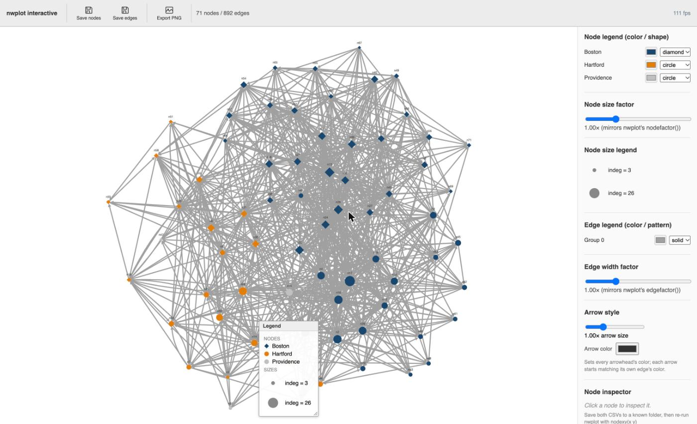

# Interactive demo: the Lazega advice network
{: .no_toc }

A printed page shows one layout, one palette and one size scale. The option `interactive` of `nwplot` writes the
same network as a web page that you can move around in. This page lets you try it without installing anything:
the view below is an ordinary file produced by `nwplot`. It works in your browser and does not contact any server.

If you are reading the book *Network Analysis with Stata* (forthcoming, Stata Press), this is the live version
of the kind of view that its section on interactive plots describes. Reading the book is not needed to use the
page, and the page does not need Stata.

1. TOC
{:toc}

## The network

The data are the advice network of the 71 lawyers of a corporate law firm (Lazega 2001). A tie runs from a
lawyer to the colleague whom she asks for advice; there are 892 ties. In the view, **color** is the office
(Boston, Hartford, Providence), **shape** is the practice (corporate or litigation) and **size** is the number of
colleagues who ask the lawyer for advice (indegree). Labels are the node identifiers (`n1` to `n71`).

<iframe src="lazega_advice_interactive.html" width="100%" height="700" style="border:1px solid #d0d7de; border-radius:6px;" loading="lazy" title="Interactive view of the Lazega advice network"></iframe>

The side panel needs about 900 pixels of width. On a phone or in a narrow window, open the
[view in its own page](lazega_advice_interactive.html).



*Still image of the view when it opens. If the live view above does not load (it needs JavaScript), this is what it shows.*

## What to try

- **Drag a node.** Press on a symbol and move it; its ties follow. Move one of the large symbols away from the
  center and watch how many ties go with it. Click a node (without moving it) to see its label, group, color,
  shape, size and position in the inspector at the bottom of the side panel.
- **Click a color swatch** in the node legend to recolor everybody in that group at once; the drop-down next to it
  changes the shape of the group. Providence has only three lawyers, so it is a good group to recolor. (The
  legend box on the canvas is the one to read for shapes: the drop-down in the side panel shows "mixed" for a group
  whose members have different shapes.)
- **Move the sliders** for node size and edge width. They correspond to the options `nodefactor()` and
  `edgefactor()` of `nwplot`, so a value you like can be typed into the next call. Thin lines make the nodes
  show through; a pattern that disappears when the lines are thin was carried by the number of lines.
- **Move the legend box** on the canvas out of the way before you export a picture.
- **Save.** *Save nodes* and *Save edges* write two small CSV files (`nwedit_nodes.csv` and `nwedit_edges.csv`)
  with positions, colors, shapes and the slider values. In most browsers they end up in your Downloads
  folder. *Export PNG* writes a picture of what you see, including the legend.

The page is a demonstration of the view. It has no data entry, and what you change is not stored on this site.

## The Stata commands

The page above was written by these commands (core 3.4.0 or later; the data set `lazega` is in the repository and
is loaded with `nwwebuse`):

```stata
. nwwebuse lazega, nwclear
. nwdegree lazega_adv, generate(outdeg indeg)
. set seed 42
. nwplot lazega_adv, color(office, colorpalette(navy dkorange gs12))       ///
>     symbol(practice) size(indeg) label(_nwnode) edgefactor(0.4)          ///
>     generate(x y) interactive noopen fname(lazega_advice_interactive)
```

- `generate(x y)` keeps the coordinates that `nwplot` computed, so that the layout can be recovered.
- `set seed 42` makes the starting layout repeatable (it starts from random positions).
- `interactive` builds the page. `noopen` writes it without opening Stata's viewer window; leave `noopen`
  out to have the viewer open by itself. `fname()` is the file to write; its path is displayed and returned in
  `r(fname)`.

## Bringing your edits back into Stata

The browser is for looking; a figure for print is better made in Stata, where it can be reproduced. Read the two CSV
files back with `importcoords()` and `edgeimport()`, and tell `nwplot` where the nodes were with `nodexy()`:

```stata
. nwplot lazega_adv, nodexy(x y)                                         ///
>     importcoords("nwedit_nodes.csv") edgeimport("nwedit_edges.csv")    ///
>     color(office, colorpalette(navy dkorange gs12))                    ///
>     symbol(practice) size(indeg) label(_nwnode) scheme(s1mono)         ///
>     labelopt(mlabsize(tiny)) export("lazega_advice_final.pdf") replace
```

The edits are matched to the nodes by row number, so run this on the same network, with the same sort order and the
same `if` and `in` restrictions. The slider for node size is converted so that the static plot has the proportions
of the view; an explicit `nodefactor()` or `edgefactor()` wins over the saved values. The
[visualization tutorial](../../tutorials/04-visualization/#the-workflow-explore-in-the-browser-finish-in-stata)
runs this step on a saved pair of files and shows the result, and [nwplot](../../reference/nwplot) lists all
options.

## Source and licence

- Data: Lazega, E. (2001), *The Collegial Phenomenon*, Oxford University Press; Lazega, E. and van Duijn, M. (1997),
  *Social Networks* 19, 375-397. See the [data sets](../../datasets/#lazega-lawyers-in-a-corporate-law-firm) page.
- The page was produced with nwcommands, which is free software under the GNU General Public License, version 3.
  The file contains the drawing library Cytoscape.js and other open-source code under the MIT license (the notices are in the file).
