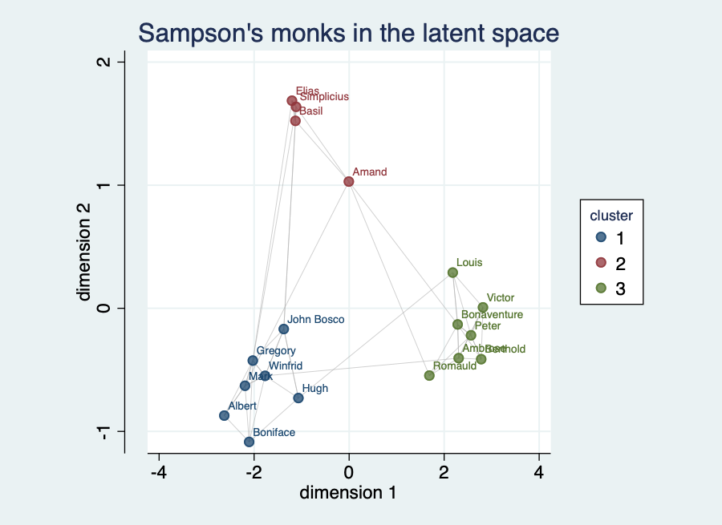

# Tutorial 2: How many latent clusters?

**Goal.** Compare latent space models with 0, 2, 3 and 4 clusters by the BIC, read what the parts of the BIC mean, see whether random sender and receiver effects change the picture, compare the clusters with groups known from outside the model, and check the fit of the model you chose, for a binary and for a valued network.

**Data.** Sampson's monastery: 18 novice monks who named the fellow monks they liked, at several times. The anthropologist Sampson observed three factions during his stay: Loyal (7 monks), Turks (7) and Outcasts (4); the faction is stored as a node attribute.
Source: Sampson, S. F. (1969), *Crisis in a Cloister*, unpublished doctoral dissertation, Cornell University; loaded with `nwwebuse sampson` (see the [data sets page](../../datasets/)). The data set holds the choices at three times (`samplk1` to `samplk3`) and a liking ranking (`samplike`).
You need the core `nwcommands` and the `nwlsm` package (see [Install](../install/)); the commands were run with `nwlsm` 0.7.0 under Stata 17.
The complete script and log are in [example.do](example.do) and [example.log](example.log). [Tutorial 1](../tutorial-1-first-lsm/) explains the model and the sampler; read it first.

## Why clusters, and why the BIC

A latent space model puts the actors in a plane. With `clusters(#)` the positions are not drawn from one normal distribution around the centre but from a mixture of that many normal distributions: the actors fall into groups that lie together in the space.
How many groups? The data do not say directly. The Bayesian information criterion (BIC) is the usual rough guide: it rewards a model for fitting the data and charges it for each additional parameter. Smaller is better, and only differences between models fitted to the same network matter.
Here we also have an outside check: three factions that were observed independently of the network model.

## The network

`nwlsm` fits a binary network, so we take the choices at the third time point and keep who was named at all:

```stata
. nwwebuse sampson, nwclear
. nwgen choice3 = samplk3 > 0
. nwsummarize choice3
   Nodes: 18
   Arcs: 56
   Density:  .183
   Mean outdegree:  3.11
```

The network has 18 actors and 56 directed ties; a monk names about three others.

## The BIC of one model

```stata
. nwlsm choice3, dim(2) seed(12)
. estat bic

BIC of the latent position model (as latentnet's bic.ergmm)
--------------------------------------------
Component                                BIC
--------------------------------------------
Ties given positions (Y)             179.952
Positions (Z)                        141.299
--------------------------------------------
Overall                              321.251
--------------------------------------------
Latent clusters: 0; coefficients: 1; effective number of observations (ties): 56
```

`estat bic` follows `bic.ergmm()` of the R package `latentnet`. The overall BIC is a sum of parts. The part for the ties given the positions (Y) is minus twice the log likelihood of the ties plus a charge of the number of coefficients times the log of the effective number of observations;
by default that number is the number of ties, here 56. The part for the positions (Z) is the same kind of number for the positions themselves: how well a normal distribution, or with clusters a mixture of normal distributions, describes where the 18 actors lie. A cluster model can only gain in this part.
Random effects, if present, add a part of their own, as we see below. The BIC is computed at the minimum Kullback-Leibler positions, which are the positions `estat positions` reports.

## Comparing 0, 2, 3 and 4 clusters

```stata
. nwlsmselect choice3, clusters(0 2 3 4) seed(12) refit

------------------------------------------------------------------------
  Clusters         BIC     BIC (Y)     BIC (Z) Mean loglik   BIC - min
------------------------------------------------------------------------
         3     285.170     185.608      99.562     -96.860       0.000  <- best
         4     292.719     182.183     110.536     -96.509       7.549
         2     294.992     185.482     109.509     -96.763       9.821
         0     321.251     179.952     141.299     -94.964      36.081
------------------------------------------------------------------------
```

`nwlsmselect` fits the model once for every number of clusters in `clusters()`, with the same options and the same seed, and ranks the fits by BIC. Zero clusters means no clusters. `refit` fits the best model again so that it is the active model afterwards. The table is also stored in `r(table)` and the best number of clusters in `r(best)` (here 3).

Read the parts. The part for the ties barely moves: 180.0 without clusters, between 182.2 and 185.6 with them, and the mean log likelihood is about the same. Clusters do not make the ties fit better. What changes is the part for the positions: with three clusters it falls from 141.3 to 99.6.
The gain of 41.7 in that part and the loss of 5.7 in the part for the ties leave three clusters 36.1 points ahead of no clusters. Two clusters are 9.8 behind and four clusters 7.5. A difference of about 10 points is usually called strong, a difference below 2 or 3 hardly worth mentioning,
so here the BIC clearly prefers three clusters over none and over two, and moderately over four. The BIC is a rough guide, and `latentnet` itself warns that it is not certain to be right for comparing clustered with unclustered models.

## Do the clusters match the factions?

The BIC tells us that three clusters describe the positions best. It does not tell us that the clusters mean anything. Here we can check: `estat clusters` gives the classification and the posterior membership probabilities, and the factions are a variable in the data.

```stata
. estat clusters, generate(grp) nolist
. tabulate grp_class faction

           |             faction
 grp_class |     Loyal   Outcasts      Turks |     Total
-----------+---------------------------------+----------
         1 |         0          0          7 |         7
         2 |         0          4          0 |         4
         3 |         7          0          0 |         7
-----------+---------------------------------+----------
     Total |         7          4          7 |        18
```

To see the clusters, draw the monks in the latent space with `nwlsmplot`; the option `clusters` colours each monk by cluster and `label()` names them:

```stata
. nwlsmplot, clusters label(_nwnode) title("Sampson's monks in the latent space")
. graph export "monks_clusters.png", width(900) replace
```



The three groups lie apart: seven monks in the lower left, seven on the right and a small group of four at the top. Ties run mostly inside each group, and the few ties between groups run through the space between them. The small group at the top is the faction of the outcasts, and one of its four monks lies between it and the rest. Only distances count on this map: the axes can be turned or flipped without changing the model.

The three clusters of the model are the three factions, with no monk in the wrong place. The numbering of the clusters is arbitrary; only the grouping counts. The model has never seen the faction variable. How sure is it about each monk?

```stata
. generate pmax = max(grp_p1, grp_p2, grp_p3)
. summarize pmax
        pmax |         18    .8805972    .0924528       .645       .977
. count if pmax < 0.8
  3
```

The probability of the assigned cluster is on average 0.88, between 0.65 and 0.98; for 3 of the 18 monks it is below 0.8. So the clusters are clear, but not every monk is placed with certainty, which is what we expect from a network of 56 ties.
Compare this with a network where the BIC prefers clusters but the membership probabilities all lie near one half: there the clusters would be an artefact. Always check the probabilities, not only the BIC.

## Random sender and receiver effects

The network is directed. Some monks may be named more often than others, and some may name others in a particular way. `sender` and `receiver` give every actor a random effect for the tendency to send and to receive ties.

```stata
. nwlsmselect choice3, clusters(0 2 3 4) sender receiver seed(12)

------------------------------------------------------------------------
  Clusters         BIC     BIC (Y)     BIC (Z) Mean loglik   BIC - min
------------------------------------------------------------------------
         3     287.176     160.828     108.071     -90.822       0.000  <- best
         4     287.485     160.870     109.345     -90.826       0.309
         2     301.541     161.693     117.032     -90.879      14.366
         0     372.325     154.757     156.427     -88.249      85.149
------------------------------------------------------------------------

. nwlsm choice3, dim(2) clusters(3) sender receiver seed(12)
. estat bic

--------------------------------------------
Component                                BIC
--------------------------------------------
Ties given positions (Y)             160.828
Positions (Z)                        108.071
Random effect: sender                 -8.749
Random effect: receiver               27.025
--------------------------------------------
Overall                              287.176
--------------------------------------------
```

Three clusters are still best, but now four are only 0.3 points behind, which is no difference at all. The no-cluster model is 85.1 points behind. There are two new parts in the BIC, one for the sender effects and one for the receiver effects. The part for the ties falls from 185.6 to 160.8, but the new parts and the larger part for the positions take it back:
the overall BIC of the best model is 287.2, slightly higher than the 285.2 of the model without the effects. For these data the random effects do not pay off, and the simpler model is preferred (the sender part is even negative).
Almost all monks name the same number of others (see the out-degrees below), so there is little for sender effects to explain, and the plain model is the natural choice.

## The default number of starting points

The positions and effects in the BIC come from an optimisation, the minimum Kullback-Leibler fit, which can end in a poor local optimum. With `sender`, `receiver` or `sociality`, `nwlsm` starts it from four points by default and keeps the best result (`e(mklstarts)` is 4); without random effects it uses one, as `latentnet` does.
You can set it with `mklstarts(#)`. Here the choice does not matter at all: with `mklstarts(1)` the BIC is again 287.176, to three decimals. On networks with weakly identified random effects a single start can end in the poor optimum and inflate the random-effect parts of the BIC; the default protects against that and costs a little time.

## The effective number of observations

The charge of the BIC for the coefficients uses the log of an effective number of observations. The default is the number of ties (56). `effobs(dyads)` and `effobs(actors)` use the number of dyads (306) or of actors (18) instead. Only the part for the ties changes:

```stata
. estat bic, effobs(dyads)
Ties given positions (Y)             162.527
Overall                              288.874
. estat bic, effobs(actors)
Ties given positions (Y)             159.693
Overall                              286.041
```

Against 160.828 and 287.176 with the default, the choice moves the BIC by about two points. That is small next to the differences between the models above, but the choice matters more when you compare models with many coefficients.

## Goodness of fit, binary and valued

The BIC says which model is best of those you tried, not that it is good. `estat gof` simulates networks from the fitted model and compares them with the observed one. For the binary model with three clusters:

```stata
. nwlsm choice3, dim(2) clusters(3) seed(12)
. estat gof, gof(odegree distance) nsim(100) seed(1)

Goodness of fit: out-degree (100 networks simulated from the posterior)
------------------------------------------------------------------
  Out-degree |  Observed       Min      Mean       Max  MC p-value
-------------+----------------------------------------------------
           0 |         0         0      0.41         2        1.00
           1 |         0         0      2.10         5        0.24
           2 |         0         1      4.16         9        0.00
           3 |        16         0      4.52        10        0.00
           4 |         2         1      3.91         8        0.40
           5 |         0         0      1.91         6        0.14
...
Goodness of fit: minimum geodesic distance (100 networks simulated from the posterior)
------------------------------------------------------------------
    Distance |  Observed       Min      Mean       Max  MC p-value
-------------+----------------------------------------------------
           1 |        56        41     55.38        72        0.90
           2 |        73        44     73.18       114        0.98
           3 |        63        16     59.16        95        0.84
           4 |        45         3     38.78        62        0.78
...
         Inf |        17         0     49.62       175        0.96
------------------------------------------------------------------
```

The distances are reproduced well: every Monte Carlo p-value is large. The out-degrees are not. In the data 16 of the 18 monks name exactly three others, probably a feature of how the choices were collected; the model, which knows nothing about such a restriction, simulates networks with out-degrees spread from 0 to 9 and therefore misses degree 2 and degree 3
(p-values 0.00). A fit table is a reason to think about the data collection, not only about the model.

For a valued network the dyads carry values. The liking ranking `samplike` has the values 0 to 3. We fit it with the binomial family and three trials, with three clusters:

```stata
. nwlsm samplike, family(binomial) trials(3) dim(2) clusters(3) seed(12)
. estat gof, gof(distance values) nsim(100) seed(1)

Goodness of fit: tie values (100 networks simulated from the posterior)
------------------------------------------------------------------
       Value |  Observed       Min      Mean       Max  MC p-value
-------------+----------------------------------------------------
           0 |       218       177    198.45       218        0.02
           1 |        38        46     62.39        82        0.00
           2 |        20        21     31.85        45        0.00
           3 |        30         5     13.31        26        0.00
------------------------------------------------------------------
```

The table of values counts the dyads with each value. The observed network has more pairs with no liking (218 against 198) and more with the top value 3 (30 against 13) than the model simulates, and fewer with 1 or 2. Liking in the monastery is polarised: a monk likes some monks a lot and ignores the others,
while the binomial family with one probability per pair makes the middle values too likely.

The structure statistics (degrees, shared partners, distances) are computed on a binary network, by default the dyads with a value above 0. `cutoff(#)` moves that threshold; the observed and the simulated networks are cut in the same way:

```stata
. estat gof, gof(distance) nsim(100) seed(1) cutoff(1)
...
Degree, shared partners and distances are those of the network of the dyads
with a value above 1.
```

With `cutoff(1)` the network has only the strong likes, the 50 pairs with a value of 2 or 3, and the table of distances shows no cell with a p-value below 0.08. The model reproduces the structure of the strong ties well even though it misses the distribution of the values (the full table is in [example.log](example.log)).

## What to remember

- `estat bic` splits the BIC into a part for the ties given the positions, a part for the positions and a part for each random effect. Compare models of the same network only, and read the parts, not only the sum.
- `nwlsmselect` fits the model for several numbers of clusters and ranks them. With `refit` the best model is the active one afterwards.
- A small BIC difference (here 0.3 between three and four clusters with random effects) is no finding. A large one (36 points between three clusters and none) is.
- Look at what the clusters are: `estat clusters` gives the classification and the membership probabilities, and a cross-tabulation with a known group shows whether the clusters mean something. Here they reproduce the factions.
- Random effects add parts to the BIC and have to pay for them. For these data they do not.
- The BIC chooses among models; `estat gof` tells you whether the best of them is any good. For valued networks use `cutoff()` to look at the strong ties.
- For a stochastic block model of a network, where the number of blocks is chosen by a likelihood criterion, see the [nwsbm tutorial](../../nwsbm/tutorial-1-first-sbm/).
