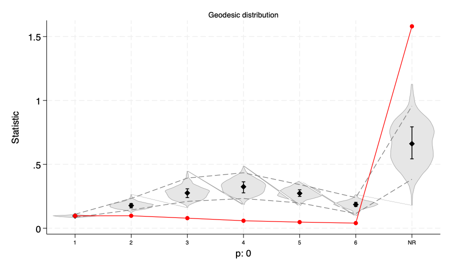
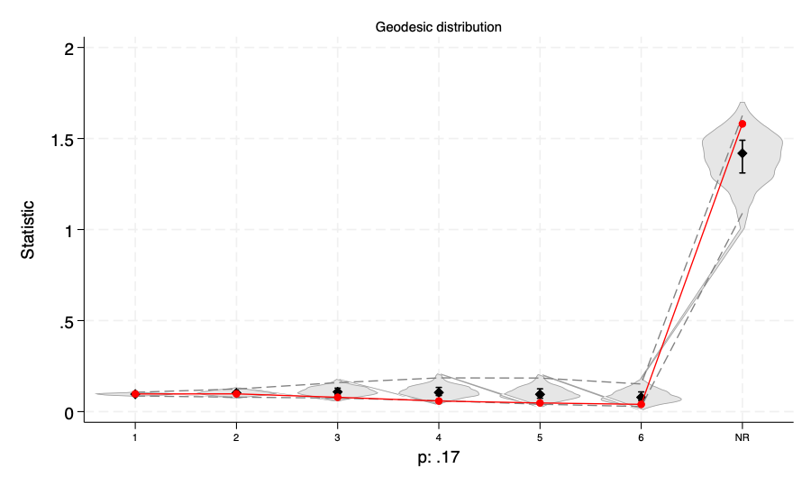

# Tutorial 3: Goodness of fit, and fixing a poor model

**Goal.** A converged model is not necessarily a good model. Here you learn to ask whether the
model can reproduce features of the data that you did *not* put into it, and what to do when it
cannot.

**Data.** The Glasgow friendship data (see [Tutorial 1](../tutorial-1-first-saom/)). Script and
log: [example.do](example.do), [example.log](example.log).

## The idea

A fitted SAOM can be used as a simulator. `estat gof` simulates the model many times at the
estimated coefficients (100 here, with `nsim(100)`) and compares the simulated end networks with the observed one on a
statistic you did not fit directly. The default statistics are the same three that RSiena's
`sienaGOF` uses: the out-degree distribution, the in-degree distribution and the distribution of
geodesic distances ("how many pairs are 1, 2, 3, ... steps apart, or not reachable at all").
A test then asks whether the observed value lies inside the cloud of simulated ones. It is the
Mahalanobis-distance test of Lospinoso and Snijders (2019), and a small p-value (below 0.05) is
evidence **against** the model on that statistic. A large p-value is not proof that the model is right; it only means that this
particular check did not find a problem.

## A thin model

Start with the two effects that every model has, `outdegree` and `reciprocity`:

```stata
. nwsaom, waves(glasgow1 glasgow2 glasgow3) outdegree reciprocity seed(1)
...
------------------------------------------------------------------------------
glasgow1_t~3 | Coefficient  Std. err.      z    P>|z|     [95% conf. interval]
-------------+----------------------------------------------------------------
   outdegree |  -2.378798   .1097313   -21.68   0.000    -2.593868   -2.163729
 reciprocity |   2.860568     .18893    15.14   0.000     2.490272    3.230864
------------------------------------------------------------------------------
...
Overall maximum convergence ratio: 0.054 (good; all t-ratios below 0.1)
```

The model converged. Is it any good?

```stata
. estat gof, nsim(100) seed(7)

Goodness of fit: Mahalanobis distance test, 100 simulations at the estimates (2 periods pooled)
------------------------------------------------------------
Outdegree     | Mahalanobis dist. =    5.875   p =  0.550 (no evidence against fit)
Indegree      | Mahalanobis dist. =    8.594   p =  0.370 (no evidence against fit)
Geodesic      | Mahalanobis dist. =  209.758   p =  0.000 (evidence AGAINST fit)
------------------------------------------------------------
p < 0.05: the observed statistic is unlikely under the fitted model (one-tailed test).
Violin plots: gof_outdegree gof_indegree gof_geodesic
```

The degree distributions are reproduced, but the geodesic distribution is not (distance 209.8, p
below 0.001). The command also draws a violin plot for every statistic; they are named
`gof_outdegree`, `gof_indegree` and `gof_geodesic` and can be saved with `graph export`:

```stata
. graph export "gof_thin_geodesic.png", name(gof_geodesic) width(900) replace
```



How to read a violin plot: for every category on the horizontal axis (distance 1, 2, ..., 6, and
"NR" for pairs that cannot reach each other) the grey shape is the distribution of the statistic
over the simulated networks, the thin box inside it the interquartile range, the dashed lines the
2.5th and 97.5th percentiles, and the **red line is the observed value**. A fit
is good when the red line stays inside the dashed envelope. Here it does not: the model cannot
produce a network that looks like the real one in terms of distances.

## Add effects that capture clustering

Friendship networks have more triangles than reciprocity alone can create. Add transitive triplets,
and the two degree effects `indegpopularity` and `outactivity`:

```stata
. nwsaom, waves(glasgow1 glasgow2 glasgow3) outdegree reciprocity transtrip indegpopularity outactivity seed(1)
...
Overall maximum convergence ratio: 0.089 (good; all t-ratios below 0.1)

. estat gof, nsim(100) seed(7)

Goodness of fit: Mahalanobis distance test, 100 simulations at the estimates (2 periods pooled)
------------------------------------------------------------
Outdegree     | Mahalanobis dist. =    3.318   p =  0.870 (no evidence against fit)
Indegree      | Mahalanobis dist. =    6.876   p =  0.490 (no evidence against fit)
Geodesic      | Mahalanobis dist. =   19.007   p =  0.000 (evidence AGAINST fit)
------------------------------------------------------------
```

The distance fell from 209.8 to 19.0, which is a large improvement, but the p-value is still below
0.001. A good habit is to improve the model one step at a time and to look at the same
statistic again.

## A better model

The next step is to combine the plain transitive-triplets count with the
geometrically weighted edgewise shared partner effect `gwesp(.69)`, which lets the benefit of an extra
common friend fade, and add `outpopularity`:

```stata
. nwsaom, waves(glasgow1 glasgow2 glasgow3) outdegree reciprocity gwesp(.69) transtrip indegpopularity outactivity outpopularity seed(1)
...
---------------------------------------------------------------------------------
glasgow1_to_g~3 | Coefficient  Std. err.      z    P>|z|     [95% conf. interval]
----------------+----------------------------------------------------------------
      outdegree |  -1.250331   .5142486    -2.43   0.015     -2.25824   -.2424224
    reciprocity |   2.865521   .3582165     8.00   0.000      2.16343    3.567613
indegpopularity |  -.3861618   .5134133    -0.75   0.452    -1.392433    .6201099
    outactivity |  -.1657485    .052155    -3.18   0.001    -.2679703   -.0635266
      transtrip |   -.452402   .4809604    -0.94   0.347    -1.395067    .4902631
      gwesp_.69 |   3.278733   1.322956     2.48   0.013     .6857865    5.871679
  outpopularity |  -.3304203   .3708519    -0.89   0.373    -1.057277    .3964361
---------------------------------------------------------------------------------
...
Overall maximum convergence ratio: 0.150 (good; all t-ratios below 0.1)

. estat gof, nsim(100) seed(7)

Goodness of fit: Mahalanobis distance test, 100 simulations at the estimates (2 periods pooled)
------------------------------------------------------------
Outdegree     | Mahalanobis dist. =    3.688   p =  0.830 (no evidence against fit)
Indegree      | Mahalanobis dist. =    4.087   p =  0.790 (no evidence against fit)
Geodesic      | Mahalanobis dist. =    8.904   p =  0.170 (no evidence against fit)
------------------------------------------------------------
```

All three statistics are now within what the model can produce.



The red line follows the center of the simulated distributions, including the large "NR" category
(pairs without a path between them). Three remarks on this model:

- The clustering is carried by `gwesp_.69` (3.28, z = 2.5); with it in the model `transtrip` is
  not significant. The two effects overlap, so do not interpret them separately; what matters for
  goodness of fit is that together they reproduce the distances.
- `outactivity` is negative: pupils who already name many friends are less eager to name even more.
  
- Several of the effects in the model are individually not significant. Goodness of fit is not about
  significance: an effect can be needed to fit the data without being "significant" on its own, and
  you should not remove an effect only because its p-value is above 0.05.

## More statistics, and one test per period

The triad census (the counts of the 16 triad types, RSiena's `TriadCensus`) is not part of the
default. It can be requested explicitly:

```stata
. estat gof, nsim(100) seed(7) stats(triad)

Goodness of fit: Mahalanobis distance test, 100 simulations at the estimates (2 periods pooled)
------------------------------------------------------------
Triad         | Mahalanobis dist. =   90.343   p =  0.000 (evidence AGAINST fit)
------------------------------------------------------------
```

Even this model does not reproduce the triad census, which is a stricter test than the other three. How much
weight to give this is a judgment: you have to decide what features the model must reproduce for your
substantive question. With three or more waves the periods are by default pooled into a single test; `join(off)`
tests each period separately:

```stata
. estat gof, nsim(100) seed(7) stats(outdegree) join(off)

Goodness of fit: Mahalanobis distance test, 100 simulations at the estimates (one test per period)
------------------------------------------------------------
Outdegree (period 1)    | Mahalanobis dist. =    3.863   p =  0.730 (no evidence against fit)
Outdegree (period 2)    | Mahalanobis dist. =    7.579   p =  0.330 (no evidence against fit)
------------------------------------------------------------
```

## Things to try

- `estat gof, twotailed` reports a two-tailed p-value, which rejects for deviations in either direction (the default is one-tailed, as in RSiena).
- Use a larger `nsim()` (200 or more) for a final check; with 100 simulations a p-value can only change in steps of 0.01.
- Fit your own model with and without `gwesp(.69)` and compare the geodesic test.
- After a co-evolution fit `estat gof` adds a fourth test, for the behavior distribution
  ([Tutorial 4](../tutorial-4-selection-influence/)).
- The goodness-of-fit commands and options are described in `help nwsaom_estat`.

## Where next

[Tutorial 4](../tutorial-4-selection-influence/) adds a behavior that changes together with the
network. [Tutorial 5](../tutorial-5-testing-comparing/) shows how to decide *which* effects to
include with score tests, instead of trial and error.
