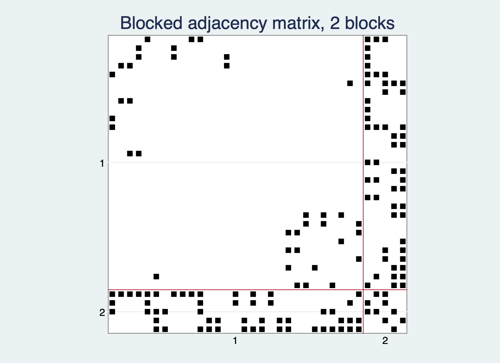
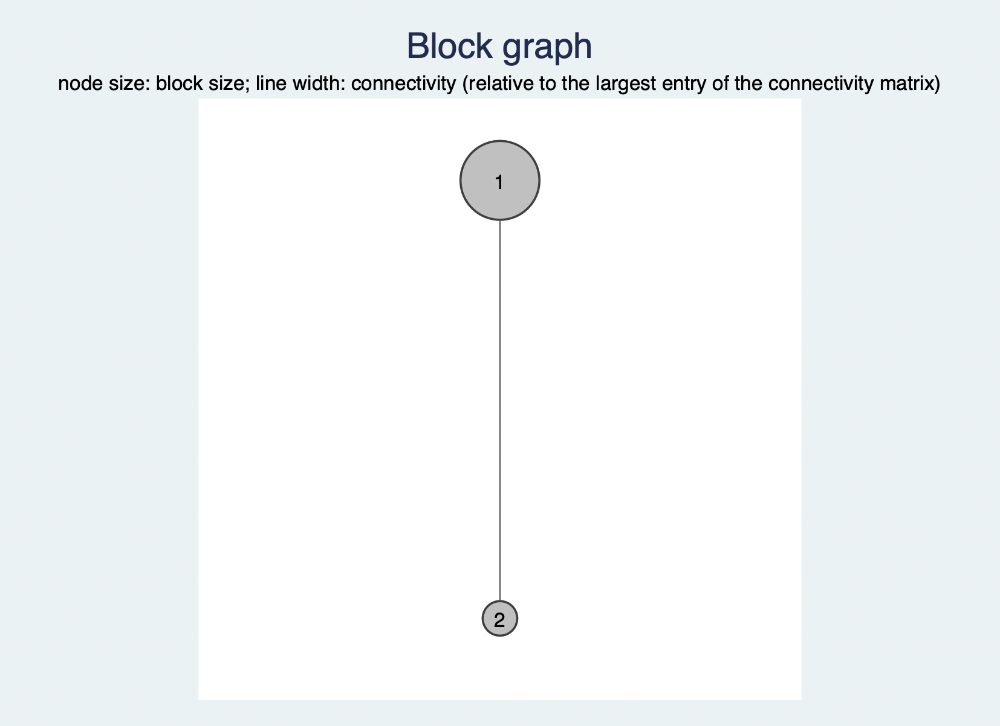
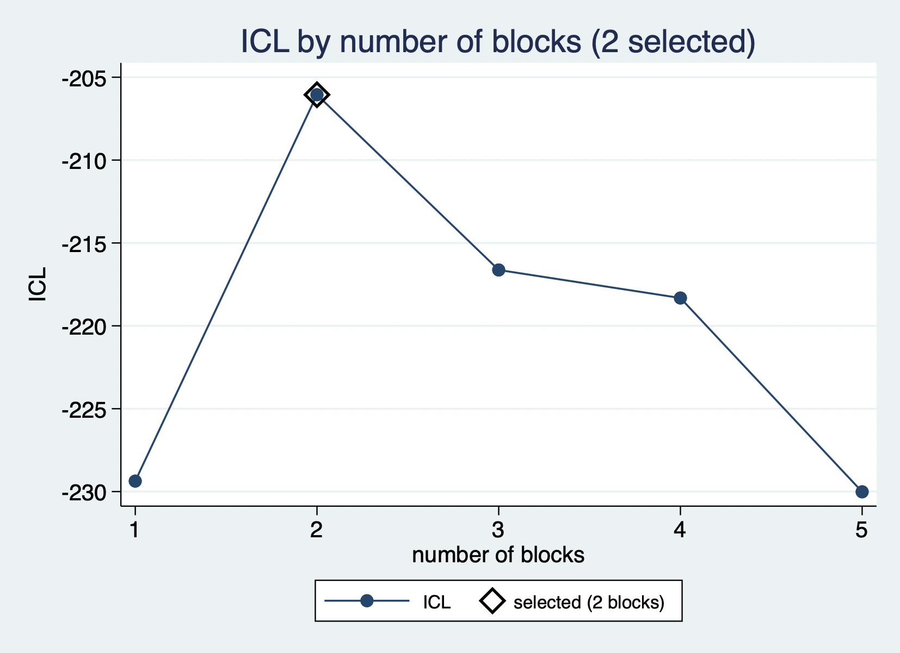
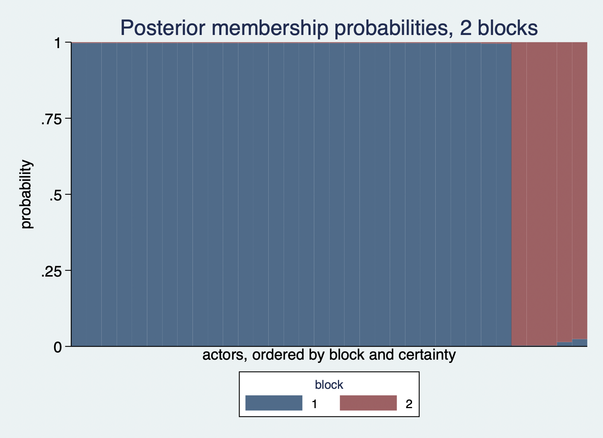

# Tutorial 1: Blocks in the karate club

**Goal.** Fit stochastic block models with `nwsbm`, let the ICL choose the number of blocks, read the block sizes and the connectivity matrix, and see that blocks are not the same thing as factions.

**Data.** Zachary's karate club: 34 members and 78 friendship ties (undirected). The club split in two after a conflict; the variable `group` records which side a member joined. Source: Zachary, W. W. (1977),
*Journal of Anthropological Research* 33, 452-473; loaded from the website with `nwwebuse zachary` (see the [data sets page](../../datasets/)). You need the core `nwcommands` and the `nwsbm` package
(see [Install](../install/)); the commands were run with `nwsbm` 1.0.0 under Stata 17. The complete script and log are in [example.do](example.do) and [example.log](example.log).

## What a stochastic block model does, in four sentences

Every actor belongs to one of a few blocks that are not observed. The probability of a tie between two actors depends only on their two blocks: there is one probability for each pair of blocks (a small matrix),
including the probability of a tie within a block. The model finds the blocks and the matrix that make the observed network most likely. How many blocks there should be is not set in advance: the model is fitted for every number of blocks from one to a maximum, and
the integrated classification likelihood (ICL) is the criterion that rewards fit and penalizes the number of parameters and the vagueness of the memberships.

## Fit one to five blocks

```stata
. nwwebuse zachary, nwclear
. nwsbm zachary_bin, maxblocks(5) seed(20261120) generate(block) replace
  2

Stochastic block model (bernoulli, undirected)             Actors    =        34
Network: zachary_bin                                       Blocks    =         2
                                                           ICL       =   -206.06
                                                           Lower bound J=   -193
> .95

--------------------------------------------------------------
      Blocks |         ICL           J          PL  parameters
-------------+------------------------------------------------
          1  |     -229.37     -226.20     -226.20           1
          2* |     -206.06     -193.95     -194.80           3
          3  |     -216.63     -189.07     -194.11           6
          4  |     -218.32     -177.58     -181.38          10
          5  |     -230.01     -171.03     -175.49          15
--------------------------------------------------------------
* selected by the largest ICL

Block sizes:

    b1  b2
r1  29   5
Block proportions:

        b1      b2
r1  0.8517  0.1483
Block connectivity, tie probability, from the row block to the column block:

        b1      b2
b1  0.0476
b2  0.3680  0.4937
```

The table lists the ICL for each number of blocks; the largest ICL is marked and selected, here two blocks. `J` is the lower bound of the log likelihood that the variational algorithm maximizes, and `PL` its value at the final partition; they rise with the number of blocks, as every
fit does, which is why a penalized criterion is needed. `generate(block)` stored the most probable block of every actor in the variable `block`; the posterior probabilities are stored as well.

## The selected blocks

```stata
. estat icl

Model selection by the integrated classification likelihood (ICL), bernoulli mod
> el
----------------------------------------------------------------------------
      Blocks |          ICL           J          PL           H  parameters
-------------+--------------------------------------------------------------
          1  |      -229.37     -226.20     -226.20        0.00           1
          2* |      -206.06     -193.95     -194.80        0.85           3
          3  |      -216.63     -189.07     -194.11        5.05           6
          4  |      -218.32     -177.58     -181.38        3.80          10
          5  |      -230.01     -171.03     -175.49        4.46          15
----------------------------------------------------------------------------
* largest ICL
```

```stata
. estat blocks

Blocks
---------------------------------------------
  Block |      Size  Proportion        Within
--------+------------------------------------
      1 |        29      0.8517        0.0476
      2 |         5      0.1483        0.4937
---------------------------------------------
Within: connectivity within the block (the diagonal of the connectivity matrix).
```

The model has found a block of 29 actors that are rarely tied to each other (a tie probability of 0.05 inside the block) and a small block of 5 actors that are tied to each other (0.49) and to the large block (0.37). That is a
core and a periphery and not two groups of friends: it is a statement about the role of the actors in the pattern of ties.

## Looking at the blocks

`nwsbmplot` draws pictures of the last fit. Every plot can be written to a file with `export()` (the format follows the extension: `.png`, `.pdf`, `.eps`); the pictures on this page were made that way.

```stata
. nwsbmplot, type(matrix) export(nwsbm1_matrix.png)
```



The blocked adjacency matrix draws every tie as a black square, with the members ordered by their block: the 29 members of block 1 first (top rows, left columns), the 5 members of block 2 last, and red lines between the blocks. The square of block 1 with block 1 (top left) is mostly empty, with ties scattered here and there. The rows and columns of block 2 (the bottom strip and the right strip) are
crowded with squares, and so is the small square where block 2 meets block 2 (bottom right). This is the pattern of the connectivity matrix above: a few ties inside the large block, many to and within the small one.

```stata
. nwsbmplot, type(blocks) export(nwsbm1_blocks.png)
```



The block graph draws each block as a circle whose size follows the number of members (the large circle is block 1, the small one block 2) and the connectivity between the blocks as a line whose width follows the tie probability relative to the largest entry of the connectivity matrix. Here there are two circles and one line, the 0.37 between the blocks. Ties inside a block are not drawn, which is why the dense small block does not show its 0.49.

```stata
. nwsbmplot, type(icl) export(nwsbm1_icl.png)
```



The ICL curve plots the ICL column of the table: it climbs steeply from one block (-229.4) to two blocks (-206.1), where the diamond marks the selected number, and falls again for three (-216.6), four (-218.3) and five blocks (-230.0). A curve with a clear peak, as here, is a more comfortable basis for the choice than a flat one.

```stata
. nwsbmplot, type(membership) export(nwsbm1_membership.png)
```



The membership plot shows, for every member, the posterior probability of each block as a stacked bar (blue for block 1, red for block 2), the members ordered by block and, within a block, by decreasing certainty. Nearly all bars are of one colour: the 29 members of block 1 are almost certainly in it, and the 5 of block 2 are as well. Only the last two bars on the right carry a thin sliver of the other colour, so the memberships are sharp and the hard assignment in `block` loses little.

## Blocks are not factions

```stata
. tabulate block group

     nwsbm |
     block |         group
     (MAP) |         1          2 |     Total
-----------+----------------------+----------
         1 |        13         16 |        29 
         2 |         3          2 |         5 
-----------+----------------------+----------
     Total |        16         18 |        34 
```

The two factions of the club are spread over the large block almost evenly (13 and 16 members), so the blocks say nothing about which side a member took. A block model does not look for groups that have many ties inside.
If you want groups with many ties inside, use `nwcommunity` of the core; if you want the same pattern as a map, use [nwlsm](../../nwlsm/).

## Forcing three blocks

```stata
. nwsbm zachary_bin, blocks(3) seed(20261120) generate(block3) replace
  3

Stochastic block model (bernoulli, undirected)             Actors    =        34
Network: zachary_bin                                       Blocks    =         3
                                                           ICL       =   -216.63
                                                           Lower bound J=   -189
> .07

Block sizes:

    b1  b2  b3
r1  13   5  16
Block proportions:

        b1      b2      b3
r1  0.4129  0.1491  0.4380
Block connectivity, tie probability, from the row block to the column block:

        b1      b2      b3
b1  0.1606
b2  0.2523  0.4953
b3  0.0017  0.4740  0.0385

. tabulate block3 group

     nwsbm |
     block |         group
     (MAP) |         1          2 |     Total
-----------+----------------------+----------
         1 |         5          8 |        13 
         2 |         3          2 |         5 
         3 |         8          8 |        16 
-----------+----------------------+----------
     Total |        16         18 |        34 

```

With `blocks(3)` the model splits the large block into two parts (13 and 16 actors) that are tied to the small block with probabilities of 0.25 and 0.47, and the ICL of this fit (-216.6) is lower than that of two blocks (-206.1), so the criterion does not support the third block.
The three blocks do not follow the two factions either (see the cross-tabulation in the log).

## What to remember

- Choose the number of blocks by the ICL, not by eye; look at the whole table, because the criterion can be flat.
- A block is a role in the pattern of ties. Compare the blocks with an outside variable (here the faction) to learn what the roles correlate with.
- Missing ties are left out of the fit, and valued, directed and two-mode networks have their own options; see `help nwsbm`.
- For other approaches to the same kind of question see [Which package do I need?](../../which-package/#latent-space-block-model-or-ergm).
