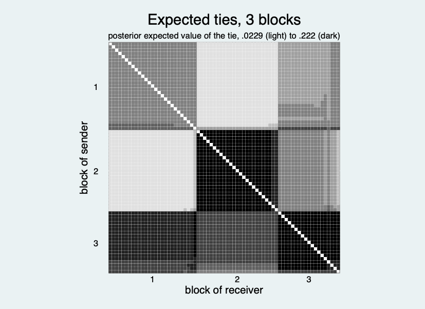
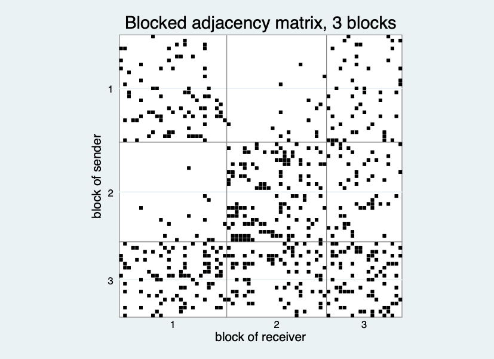
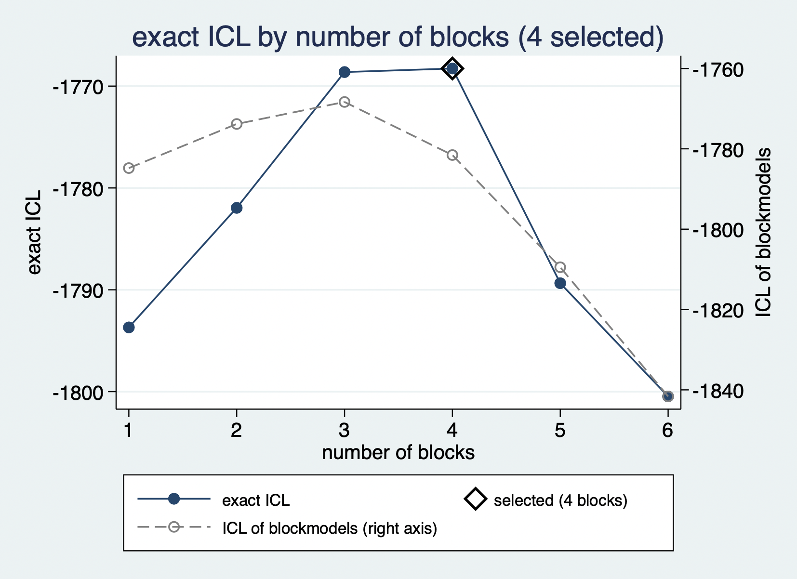
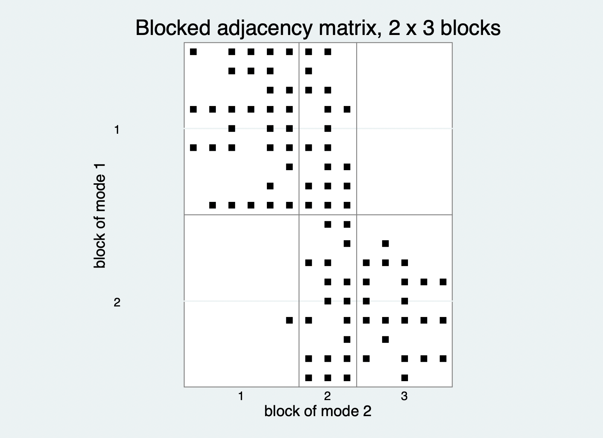
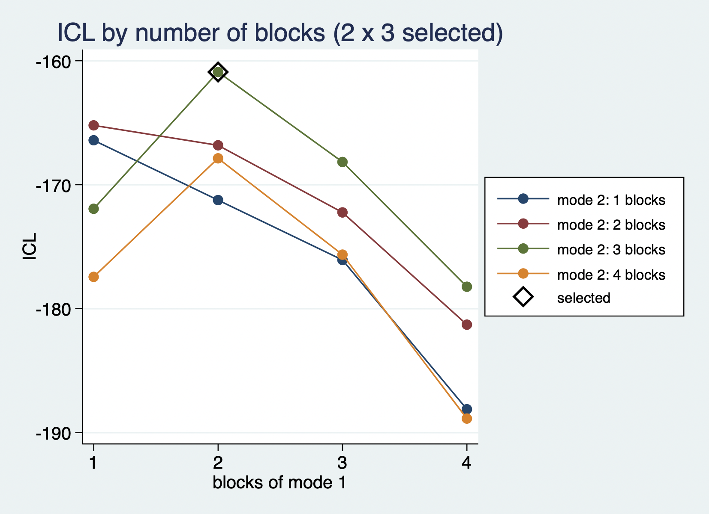

# Tutorial 2: Covariates, the exact ICL and two-mode blocks

**Goal.** Add covariates to a block model and read their standard errors, choose the number of blocks by the exact ICL and improve the partition with the `greedy` search, fit the degree-corrected model to a two-mode network, and let the Gaussian model have a variance for every pair of blocks. `orderblocks` numbers the blocks by size.

**Data.** Two data sets from the website. The first is the friendship network of 71 lawyers of a New England law firm (`lazega_fr`, directed, 575 ties), with attributes such as office, practice, gender and seniority. Source: Lazega, E. (2001), *The Collegial Phenomenon*, Oxford University Press; Lazega, E. and van Duijn, M. (1997),
*Social Networks* 19, 375-397; loaded with `nwwebuse lazega`. The second is the two-mode network of 18 women and 14 social events they attended in a Southern town in 1936 (89 ties). Source: Davis, A., Gardner, B. B. and Gardner, M. R. (1941), *Deep South*, University of Chicago Press; loaded with `nwwebuse davis` (see the [data sets page](../../datasets/)).
You need the core `nwcommands` and the `nwsbm` package (see [Install](../install/)); the commands were run with `nwsbm` 1.0.0 under Stata 17. This tutorial continues [Tutorial 1](../tutorial-1-first-sbm/), which explains the model and the ICL. The complete script and log are in [example.do](example.do) and [example.log](example.log).

## Covariates: what explains the ties besides the blocks

First the lawyers' friendship network without covariates, with one to six blocks.

```stata
. nwsbm lazega_fr, maxblocks(6) seed(20261120) generate(b0) replace nodisplay
. estat icl
...
          3* |     -1768.33    -1718.38    -1725.77        7.39           9
...
```

The ICL selects three blocks (-1768.33). `nwsbmplot` shows what the three blocks look like; `sort` orders the actors within a block by decreasing certainty of their membership, and `export()` writes the picture to a file.

```stata
. nwsbmplot, type(expected) sort export(nwsbm2_expected.png)
```



The expected plot shades every cell by the posterior expected value of the tie (the range is in the subtitle, 0.023 light to 0.222 dark; the diagonal is left out). The blocks form a pattern of rectangles: the ties of block 2 to its own members are the most probable (black), those between blocks 1 and 2 the least (light grey, in both directions), and block 3 sends and receives ties in a middle range, with the ties from block 3 to block 1 darker than those from block 1 to block 3. The picture shows the block part of the model only; covariates are not in it.

```stata
. nwsbmplot, type(matrix) sort export(nwsbm2_matrix.png)
```



The matrix plot draws the observed ties in the same order. Block 2 is a dense square, almost empty towards block 1 (the cells between blocks 1 and 2 hold only a few ties in either direction), and block 3 has ties in all its rows and columns. The observed ties are the picture behind the shaded rectangles of the expected plot. Friends, however, tend to work in the same office, in the same practice and to be of the same gender, and a block model without covariates has to find these facts through the blocks. With covariates the expected tie of a pair depends on the two blocks and on
pair-level variables: on the logit scale, a block parameter plus coefficients times the covariates. The coefficients are the same for all blocks. `same(varlist)` uses 1 if the two actors have the same value of a node variable (numeric or string), `absdiff(varlist)` the absolute difference of a numeric variable,
`signeddiff()` the signed difference (directed networks) and `covariates(netlist)` takes networks of the session.

```stata
. nwsbm lazega_fr, maxblocks(4) seed(20261120) same(office practice gender) absdiff(seniority) generate(b1) replace

--------------------------------------------------------------
      Blocks |         ICL           J          PL  parameters
-------------+------------------------------------------------
          1  |    -1651.65    -1630.38    -1630.38           5
          2* |    -1646.99    -1595.65    -1610.81           8
          3  |    -1664.83    -1587.58    -1605.25          13
          4  |    -1684.69    -1580.39    -1593.18          20
--------------------------------------------------------------
...
Covariate coefficients (logit scale):
-----------------------------------------------------------------------------
             |       Coef.   Std. err.        z     P>|z|[95% conf. interval]
-------------+---------------------------------------------------------------
abs_senior~y |    -0.01421     0.00299    -4.75     0.000  -0.02008  -0.00835
 same_office |     1.34275     0.10608    12.66     0.000   1.13484   1.55067
same_pract~e |     1.12811     0.10118    11.15     0.000   0.92981   1.32641
 same_gender |     0.25040     0.09864     2.54     0.011   0.05707   0.44373
-----------------------------------------------------------------------------
Standard errors are conditional on the estimated block memberships (they do
not reflect the uncertainty about the blocks).
```

Two things happened. The ICL is far higher than without covariates (-1646.99 against -1768.33) although the model has one parameter fewer, and the number of blocks falls from three to two (45 and 26 lawyers): much of what the three blocks had to explain is now carried by the covariates. And the coefficients come with standard errors, z values, p-values and confidence intervals.
Two lawyers in the same office have odds of a friendship tie that are exp(1.343) = 3.83 times those of two lawyers in different offices, with the same block pair and the same value of the other covariates; the same practice and the same gender raise the odds as well (the gender coefficient, 0.25, is small next to its standard error of 0.10), and each year of difference in seniority lowers them a little.

**What the standard errors are.** They are the square roots of the diagonal of the inverse information matrix of the coefficients, with the block parameters profiled out, evaluated at the estimated blocks. They are conditional on the memberships: the uncertainty about which actor belongs to which block is not in them, so they are somewhat too small
whenever the blocks are not sharp. (The R packages `sbm` and `blockmodels` report no standard errors at all.) The numbers are stored for further use.

```stata
. matrix list e(se_beta)

e(se_beta)[1,4]
      abs_senior~y   same_office  same_pract~e   same_gender
beta     .00299199     .10607885     .10117618     .09863951

. display "z of same_office: " %6.2f el(e(beta), 1, 2) / el(e(se_beta), 1, 2)
z of same_office:  12.66
```

`e(beta)` holds the coefficients, `e(se_beta)` the standard errors and `e(V_beta)` the whole variance matrix, so that you can test a contrast of two coefficients, for example whether the office and the practice effect differ, with the covariances in `e(V_beta)`. The block parameters in `e(pi)` are now those of a pair
for which all covariates are 0 (different office, practice and gender, equal seniority); they are tie probabilities of that reference pair and no longer overall tie probabilities.

## The exact ICL and the greedy search

The ICL of Tutorial 1 (the criterion of the R packages `blockmodels` and `sbm`) is a penalized value of the expected log likelihood. The exact ICL, option `icl(exact)`, is the log of the marginal likelihood of the network together with a partition, with conjugate priors (uniform priors for the block proportions and the tie probabilities); it is the criterion of the R package `greed`,
and is available for the Bernoulli model of one-mode networks and for the degree-corrected Poisson model, but not with covariates. It is evaluated at the most probable partition of the fit.

```stata
. nwsbm lazega_fr, maxblocks(6) seed(20261120) icl(exact) generate(e1) replace nodisplay
. display "exact ICL: " %9.2f e(ICL) "   criterion of blockmodels at the same fit: " %9.2f e(ICLbm)
exact ICL:  -1768.27   criterion of blockmodels at the same fit:  -1781.55
```

The exact ICL selects four blocks (-1768.27). `nwsbmplot, type(icl)` draws the path; with `icl(exact)` it adds the criterion of `blockmodels` on a second axis.

```stata
. nwsbmplot, type(icl) export(nwsbm2_icl_exact.png)
```



The solid line is the exact ICL (left axis) and the diamond marks the selected number, four blocks; three blocks are almost as good (-1768.62 against -1768.27), which is why the criterion is nearly flat between three and four and then falls steeply. The dashed grey line is the criterion of `blockmodels` (right axis), which peaks at three blocks, in agreement with the table above. The two lines are on different scales and are only compared in their shape. The two criteria differ in level, so compare values only within one criterion; `e(ICLbm)` keeps the other. The variational fit gives a partition, but the exact criterion can sometimes be improved by moving single actors. `greedy` does that: from the fitted partition of every number of blocks it moves actors
one at a time to the block that raises the exact ICL most, tries the best merge of two blocks of the solution with one block more, and keeps what is better.

```stata
. nwsbm lazega_fr, maxblocks(6) seed(20261120) icl(exact) greedy generate(e2) replace nodisplay
. display "exact ICL with greedy: " %9.2f e(ICL) " with " e(Q) " blocks"
exact ICL with greedy:  -1767.84 with 4 blocks

. tabulate e1 e2

     nwsbm |
     block |              nwsbm block (MAP)
     (MAP) |         1          2          3          4 |     Total
-----------+--------------------------------------------+----------
         1 |         1          0          0          8 |         9 
         2 |         0          0         18          0 |        18 
         3 |         0         22          0          0 |        22 
         4 |        22          0          0          0 |        22 
```

The exact ICL rises from -1768.27 to -1767.84 and the number of blocks stays four. The cross-tabulation shows what changed: one actor of the first block of the plain fit has moved to another block (the block labels are arbitrary, so the same block is called 1 in one fit and 4 in the other); everything else is the same. The improvement is small here; the search matters more when the variational partition is far from the best one.
The memberships after `greedy` are hard (probabilities 0 or 1), which is why the entropy `H` in the table is 0, and the exact ICL is never lower than without `greedy`.

## A two-mode network and the degree-corrected model

In a two-mode network the women and the events are different kinds of nodes and each mode has its own blocks (a latent block model). Give both numbers: `maxblocks(4 4)` fits every pair from 1 x 1 to 4 x 4, the table lists every pair.

```stata
. nwsbm davis, maxblocks(4 4) seed(20261120) generate(d0) replace nodisplay
. display "Bernoulli, ICL of blockmodels: " %8.2f e(ICL) ", blocks " e(Q1) " x " e(Q2)
Bernoulli, ICL of blockmodels:  -160.90, blocks 2 x 3
```

The Bernoulli model selects two blocks of women and three blocks of events.

```stata
. nwsbmplot, type(matrix) export(nwsbm2_davis_matrix.png)
```



In the two-mode matrix plot the rows are the women (two blocks) and the columns the events (three blocks), each ordered by its blocks. The first block of women attends the events of the first block and some of the second; the second block of women attends the events of the second and third blocks, and the upper right rectangle (first block of women, third block of events) is empty. The second block of events is the bridge that both groups of women attend.

```stata
. nwsbmplot, type(icl) export(nwsbm2_davis_icl.png)
```



For a two-mode network the ICL plot has one line for every number of blocks of mode 2 (the events), over the number of blocks of mode 1 (the women) on the horizontal axis. The line for three blocks of events (green) has the highest point of the plot, at two blocks of women, where the diamond marks the selection (-160.90); the other lines stay below it, and all lines fall for four blocks of women.

 The degree-corrected model (`degreecorrected` with `model(poisson)`) gives every woman and every event a degree parameter, so that blocks do not simply collect the busy and the quiet actors.
We use it with the exact ICL.

```stata
. nwsbm davis, maxblocks(4 4) seed(20261120) model(poisson) degreecorrected icl(exact) generate(d1) replace nodisplay
. display "degree-corrected, exact ICL: " %8.2f e(ICL) ", blocks " e(Q1) " x " e(Q2)
degree-corrected, exact ICL:  -307.71, blocks 1 x 1
```

`estat icl` shows the table of this fit.

```stata
. estat icl
...
      1 x 1* |      -307.71     -161.31     -161.31        0.00           1
      1 x 2  |      -307.71     -161.31     -161.90        0.59           2
...
      2 x 2  |      -313.68     -160.81     -164.56        3.74           4
...
* selected by the largest ICL (ties within 1e-9: fewest blocks)
```

Several pairs have exactly the same exact ICL as 1 x 1 (-307.71): there the fit puts all the actors of a mode into one block, so the partition is the same as with one block. When values tie, the fewest blocks are selected, and the star stands on 1 x 1.

With this criterion a single block is enough: once the degrees of the women and of the events are accounted for, the data do not support a block structure on top of them. Do not compare -307.71 with -160.90: the two criteria are on different scales (for the degree-corrected two-mode model the value leaves out the terms that do not depend on the partition, as in `greed`).
With 18 women and 14 events this is also a small network, where the exact criterion with its conjugate priors is cautious. To see what the model would say with two blocks on each side we force it, without and with the greedy search.

```stata
. nwsbm davis, blocks(2 2) seed(20261120) model(poisson) degreecorrected icl(exact) generate(d2) replace nodisplay
2 x 2, exact ICL:  -313.68
. nwsbm davis, blocks(2 2) ... icl(exact) greedy orderblocks generate(d3) replace
...
Block sizes (mode 1):

    b1  b2
r1  10   8
Block sizes (mode 2):

    c1  c2
r1   8   6
...
. tabulate d3 title if _nwmode == "1"

     nwsbm |
     block |         title
     (MAP) |      Miss        Mrs |     Total
-----------+----------------------+----------
         1 |         4          6 |        10 
         2 |         7          1 |         8 
```

The greedy search raises the exact ICL a little (from -313.68 to -313.60), and both values lie below that of one block (-307.71), so the criterion prefers one block. With `orderblocks` the blocks of each mode are numbered by size, 10 and 8 women and 8 and 6 events. `generate()` stores for every node the block of its own mode, so the cross-tabulation with an attribute of the women
(here `title`, restricted to mode 1) works as usual: the larger block of women is mostly Mrs (6 of 10), the smaller mostly Miss (7 of 8). Read this as a pattern worth a look, not as a finding, since the criterion does not support the two blocks.

## Gaussian ties: a variance for every pair of blocks

For valued ties `model(gaussian)` assumes that a tie value is normally distributed around a block mean with one common variance. To have a valued network we add the three networks of the lawyers (advice, co-work and friendship) to a count from 0 to 3.

```stata
. nwgenerate ties3 = lazega_adv + lazega_cow + lazega_fr
. nwsbm ties3, model(gaussian) maxblocks(5) seed(20261120) generate(g1) replace nodisplay
. display "one variance: ICL " %9.2f e(ICL) ", " e(Q) " blocks, variance " %6.3f e(sigma2)
one variance: ICL  -5992.99, 5 blocks, variance  0.596
```

Block pairs differ in how variable their ties are: between two blocks with almost no ties the values are almost always 0, between two busy blocks they vary. The option `blockvar` gives every pair of blocks its own variance (the number of parameters doubles).

```stata
. nwsbm ties3, model(gaussian) blockvar maxblocks(5) seed(20261120) orderblocks generate(g2) replace
...
          5* |    -5253.88    -5029.47    -5032.57          50
...
Block sizes:

    b1  b2  b3  b4  b5
r1  16  16  15  12  12
...
Block variances, from the row block to the column block:

        b1      b2      b3      b4      b5
b1  0.7186  0.0083  0.8969  0.2680  0.5017
b2  0.0170  0.5355  0.3099  0.7477  0.8811
b3  0.9595  0.2118  0.9273  0.6598  0.9173
b4  0.1743  0.6314  0.4579  1.0333  0.8736
b5  1.0276  1.0453  1.0440  1.2296  1.1364
```

The ICL rises from -5992.99 to -5253.88, a large gain. The variances run from 0.0083 (block 1 to block 2, whose mean is 0.0045: there are almost no ties) to 1.2296 (block 4 to block 5). They are in `e(sigma2_block)`, laid out like `e(pi)`; `e(sigma2)` is then the pooled residual variance (0.650). A variance cannot fall below a small floor
(0.001 times the variance of all ties), so that a block pair with hardly any ties does not produce an infinite likelihood. The blocks found are different from those of the one-variance fit (see the cross-tabulation in the log): the model now sorts actors also by how variable their ties are, not only by their level.
`orderblocks` numbers the blocks by decreasing size (16, 16, 15, 12, 12), and `e(pi)`, `e(alpha)`, `e(blocksize)`, `e(sigma2_block)` and the memberships of `generate()` follow that order.

Both fits stopped at the largest number of blocks that was allowed (`maxblocks(5)`), and the ICL was still rising, so the number of blocks is probably larger than five; when the selected number is the maximum, raise `maxblocks()` and fit again. A tie value that is a count from 0 to 3 is also not normal; the Gaussian model is an approximation here, chosen to show the options.

## What to remember

- Covariates enter the logit (or log) of the tie next to the block parameter; their coefficients, standard errors and variance matrix are in `e(beta)`, `e(se_beta)` and `e(V_beta)`. The standard errors are conditional on the estimated blocks.
- Covariates can replace blocks: the selected number of blocks may fall when good covariates are added. `e(pi)` then refers to a pair with all covariates equal to 0.
- `icl(exact)` is a different criterion from the default; compare ICL values only within one criterion. `greedy` improves the partition on the exact criterion and never lowers it.
- A two-mode network has blocks for each mode: `blocks(#1 #2)` or `maxblocks(#1 #2)`. The degree-corrected model also works for two-mode networks.
- `blockvar` lets the Gaussian model have a variance for every pair of blocks; `orderblocks` numbers the blocks by size. When the selected number of blocks is the maximum, raise `maxblocks()`.
- Not available: covariates together with `degreecorrected`, `icl(exact)` or `blockvar`; see `help nwsbm`.
