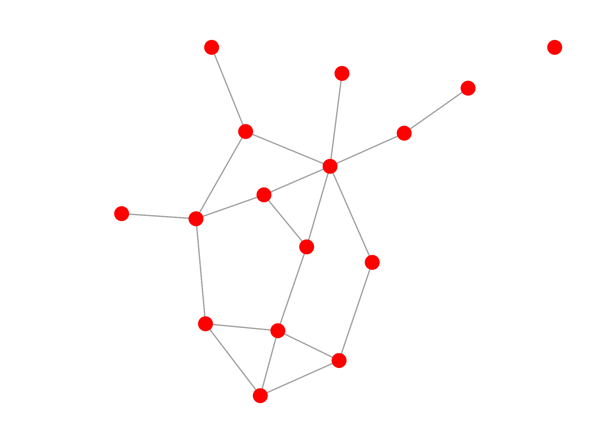
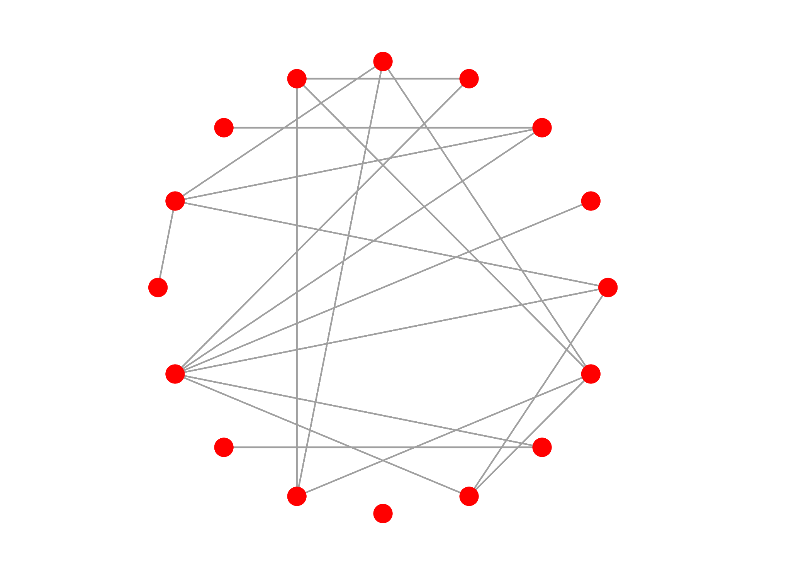
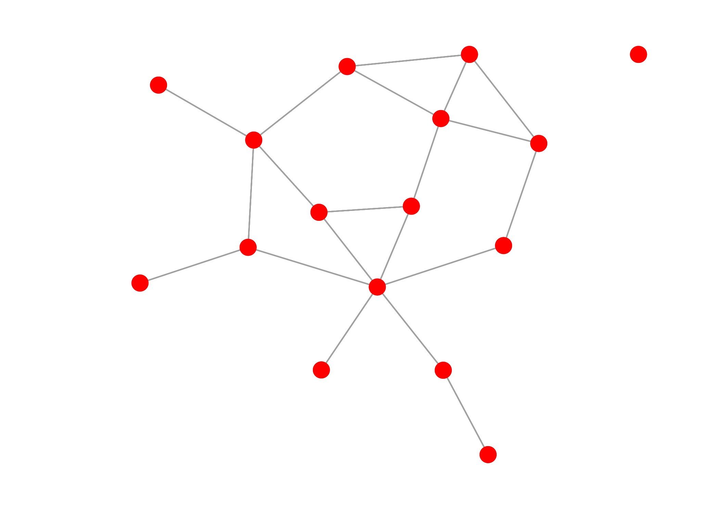
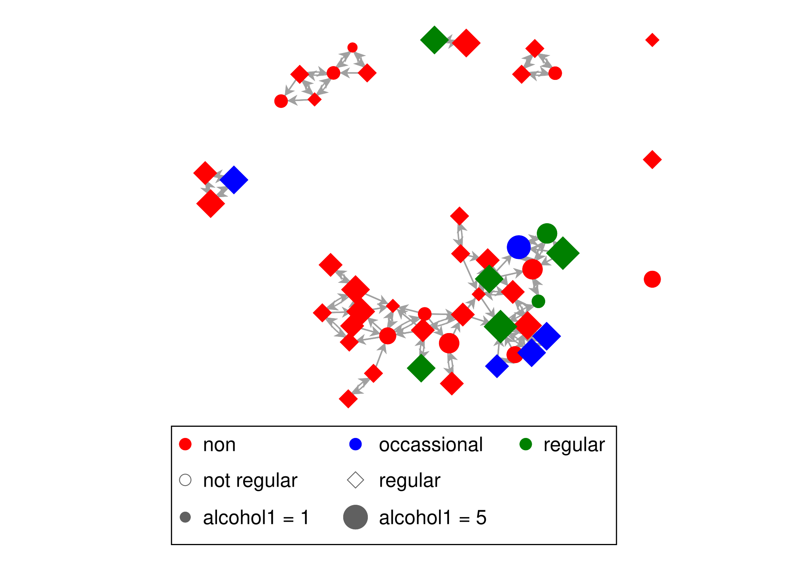
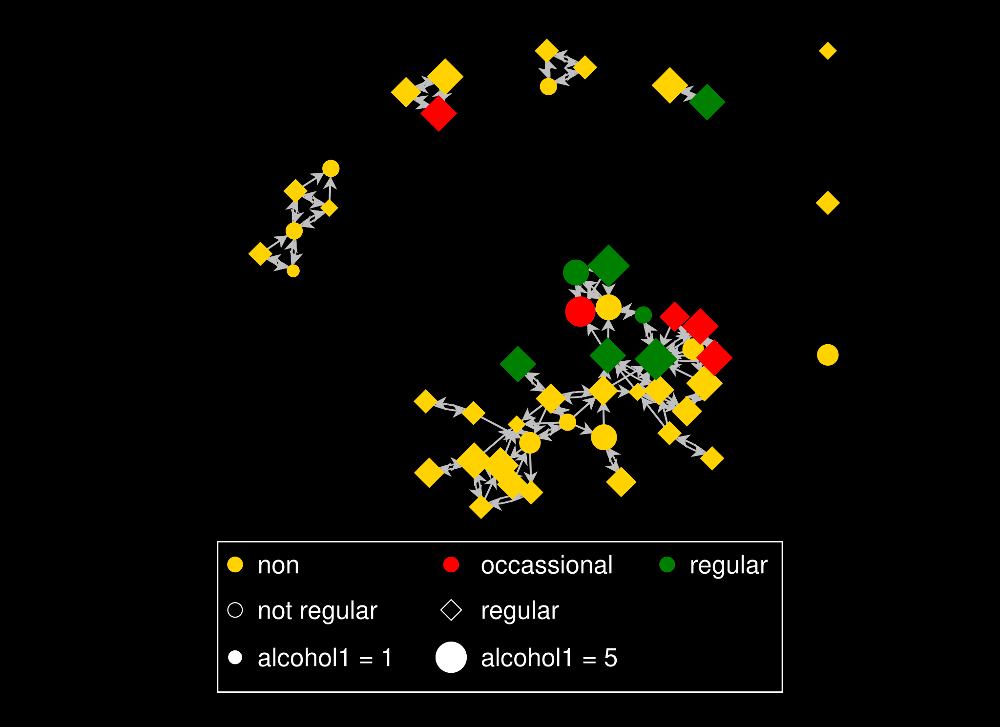
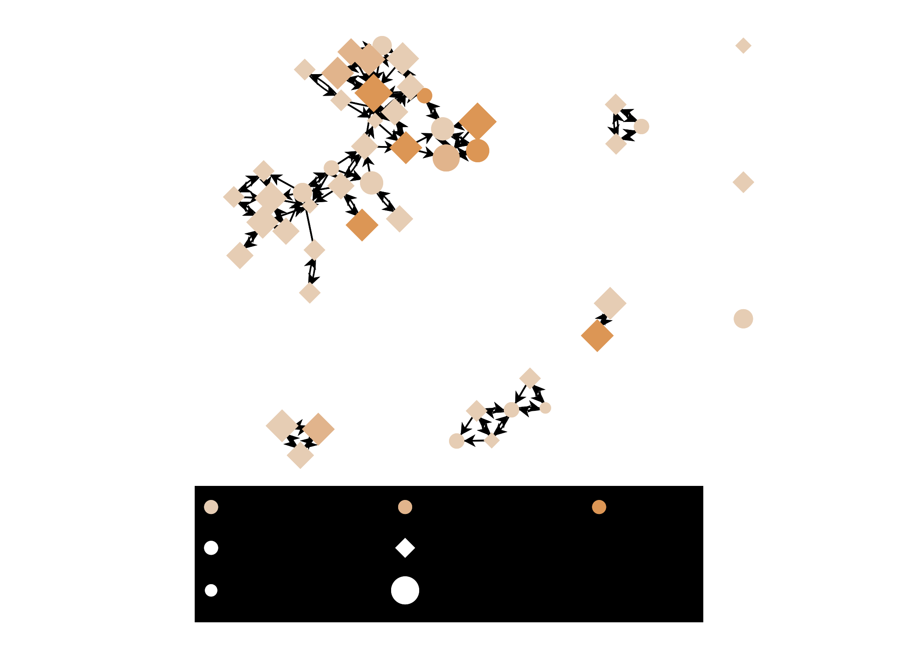
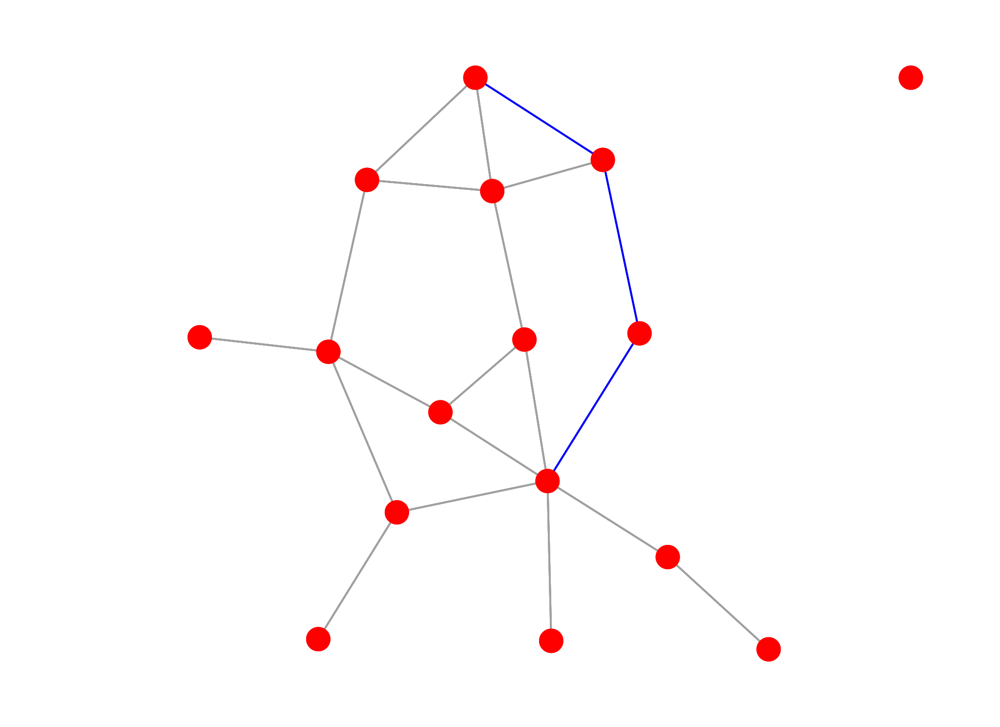
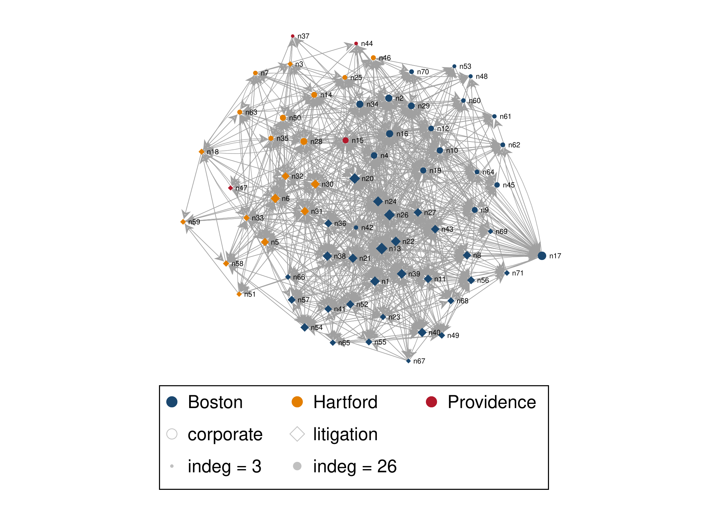

# Tutorial 5: Visualization

`nwplot` draws a network directly from the current or a named network object, with no manual
edge-list-to-coordinates plumbing required. This tutorial covers styling a static plot, exporting
publication-quality vector graphics, and building interactive and animated views of a network.

## A basic plot

With no styling options, `nwplot` just shows the structure:

```stata
. nwwebuse florentine, nwclear

. nwplot flomarriage, scheme(s1network) export("plot_basic.svg") replace
Calculating node coordinates...
Plotting network...
Exporting graph to plot_basic.svg...
file plot_basic.svg saved as SVG format
```



## Layouts

`layout()` controls how nodes are positioned. `circle` places every node on a ring; `kk`
(Kamada-Kawai) is a force-directed layout that pulls connected nodes closer together:

```stata
. nwplot flomarriage, layout(circle) scheme(s1network) export("plot_circle.svg") replace
. nwplot flomarriage, layout(kk) scheme(s1network) export("plot_kk.svg") replace
```

| `layout(circle)` | `layout(kk)` |
|---|---|
|  |  |

On a valued network the layouts `kk` and `frucht` use the tie values as strengths (since nwcommands 3.10.0, as `igraph::plot()` does for a graph with a `weight` attribute): strongly tied nodes lie closer together, and the edge widths show the same values. The option `binary` draws the layout from the pattern of ties only, as earlier versions did. A network with negative values keeps the layout of the pattern, and so do the layouts `circle`, `mds`, `hierarchy` and `bipartite`.

## Styling by attribute

`color()`, `symbol()`, and `size()` each take a variable and map its values onto the plot:

```stata
. nwwebuse glasgow, nwclear

. nwplot glasgow1, color(smoke1) symbol(sport1) size(alcohol1) scheme(s1network) export("plot_styled.svg") replace
Calculating node coordinates...
Generating splines...
Plotting network...
Exporting graph to plot_styled.svg...
file plot_styled.svg saved as SVG format
```



## Schemes

nwcommands ships three schemes purpose-built for network plots — `s1network` (used above),
`s2network`, and `s3network` — each giving node fill and edge line colors that are visually
distinct by default:

```stata
. nwplot glasgow1, color(smoke1) symbol(sport1) size(alcohol1) scheme(s2network) export("plot_scheme2.svg") replace
. nwplot glasgow1, color(smoke1) symbol(sport1) size(alcohol1) scheme(s3network) export("plot_scheme3.svg") replace
```

| `scheme(s2network)` | `scheme(s3network)` |
|---|---|
|  |  |

## Highlighting a path

Combining `nwpath` with `edgecolor()` highlights a specific route through the network — here,
the shortest path between two Medici-era Florentine families. `nwpath`'s `generate()` creates a
new network per shortest path found (`sp_1` here - a pair with multiple shortest paths would
also get `sp_2`, `sp_3`, ...), and that new network can be passed straight to `edgecolor()`:

```stata
. nwwebuse florentine, nwclear

. nwpath flomarriage, ego(medici) alter(peruzzi) generate(sp)

----------------------------------------
  Network: flomarriage
----------------------------------------
    Ego                  : medici
    Alter                : peruzzi
    Shortest path length : 3
----------------------------------------
  Path 1: medici <=> barbadori <=> castellani <=> peruzzi
  Path 2: medici <=> ridolfi <=> strozzi <=> peruzzi

. nwplot flomarriage, edgecolor(sp_1, legendoff) scheme(s1network) export("plot_path.svg") replace
```



Don't reach for `edgesize()` here to make the path stand out further - it scales edge width
*proportionally* to the variable's own value, so a 0/1 indicator like `sp_1` makes every
non-path edge exactly zero-width (invisible), leaving only the path on the plot. `edgecolor()`
alone is the right tool for a discrete highlight/no-highlight distinction like this.

## What the plot shows by default for valued, signed and two-mode networks

The networks above are binary, so every tie looks the same. Since version 3.9.0 `nwplot` shows more when the network is not binary, without any option:

- **Valued network:** the tie values set the widths of the lines (one to four units, the largest absolute value widest). `binary` draws all lines equally wide; `edgesize()` chooses the variable or the width range yourself.
- **Signed network** (a valued network with negative ties): positive ties are solid navy lines and negative ties dashed cranberry lines, with a legend; the width follows the absolute value. `nosign` switches the colours off, and an `edgecolor()` of your own replaces them.
- **Two-mode network:** the two modes get different symbols (circle, diamond) and colours, with a legend, unless `color()` or `symbol()` is given. `layout(bipartite)` puts the two modes in two rows or columns ([tutorial 11](../15-two-mode-networks/)).

`nwplotmatrix` has a legend of the value classes in the same way (`legend(off)` removes it) and, for a two-mode network, puts the nodes of one mode next to each other with a line between the modes.

## Interactive plots

`interactive` writes the plot as a self-contained web page (the drawing library is inside the file;
nothing is sent over the Internet, so you can mail the page to a colleague). In the page you drag
nodes to reposition them, click a color or shape swatch in the legend to recolor every node sharing
that value, and move two sliders for the size of the nodes and the width of the lines. The glasgow
plot below is the same view embedded live, so try it:

```stata
. nwwebuse glasgow, nwclear

. nwplot glasgow1, color(smoke1) symbol(sport1) scheme(s1network) interactive noopen fname(interactive_plot)
Calculating node coordinates...
Generating splines...
Preparing interactive view...
Interactive view written to .../interactive_plot.html
Plotting network...

. display "`r(fname)'"
.../interactive_plot.html
```

Without `noopen`, Stata opens the page in a small viewer window; with `noopen` it only writes the file.
`fname()` says where: the name you give (`.html` is added if missing; a relative name is relative to the
working directory, and an existing file is replaced). Without `fname()` the page is written to Stata's
temporary folder under a time-stamped name. Either way the path is displayed and returned in
`r(fname)`, and `r(interactive)` holds the same path.

{: .note }
Drag any node below to reposition it. Click a legend swatch to change the color assigned to that
whole group.

<iframe src="interactive_plot.html" width="100%" height="600" style="border:1px solid #d0d7de; border-radius:6px;" loading="lazy"></iframe>

### The workflow: explore in the browser, finish in Stata

The browser is for looking at the network from several sides; the figure you publish is better made
in Stata, where it can be reproduced. The steps, with the advice network of the 71 lawyers of the Lazega
law firm (color for office, shape for practice, size for the number of colleagues who ask the lawyer for
advice):

1. **Build the page and keep the layout.** `generate(x y)` stores the coordinates that `nwplot`
   computed; `set seed` makes the starting layout repeatable.
2. **Work in the page.** Drag, recolor, move the sliders, then use *Save nodes* and *Save edges*. They
   write two small CSV files (`nwedit_nodes.csv`, `nwedit_edges.csv`; in most browsers these end up in
   the Downloads folder).
3. **Bring the edits back.** `nodexy(x y)` tells `nwplot` where the nodes were, `importcoords()` and
   `edgeimport()` read the two files.
4. **Export the static figure** with `export()`.

```stata
. nwwebuse lazega, nwclear

. quietly nwdegree lazega_adv, generate(outdeg indeg)

. set seed 42

. nwplot lazega_adv, color(office, colorpalette(navy dkorange gs12)) symbol(practice) size(indeg) label(_nwnode) edgefactor(0.4) generate(x y) interactive noopen fname(lazega_advice_interactive)
Calculating node coordinates...
Generating splines...
Preparing interactive view...
Interactive view written to .../lazega_advice_interactive.html
Plotting network...
Export coordinates...
```

The page this call writes is on its own page, [Interactive demo: the Lazega advice network](../../book/interactive/).
Two CSV files saved in such a session (one node dragged, the Providence lawyers recolored, the size
slider at 1.85) are in the folder of this tutorial; they bring the edits back like this:

```stata
. nwplot lazega_adv, nodexy(x y) importcoords("lazega_saved_nodes.csv") edgeimport("lazega_saved_edges.csv") color(office, colorpalette(navy dkorange gs12)) symbol(practice) size(indeg) label(_nwnode) scheme(s1mono) labelopt(mlabsize(tiny)) export("plot_lazega_bringback.svg") replace
(9 vars, 71 obs)
(4 vars, 892 obs)
Generating splines...
Plotting network...
Exporting graph to plot_lazega_bringback.svg...
file plot_lazega_bringback.svg saved as SVG format
```



Things to know about the bring-back:

- **Sizes.** The size slider in the page is a multiplier on the page's own starting size, and the page draws
  in screen pixels. A slider value of 1 therefore corresponds to about `nodefactor(0.2)` in the static
  plot. Without `nodefactor()`, `nwplot` uses 0.2 times the saved slider value (1.85 gives
  `nodefactor(0.37)`), so the static figure has the proportions of the view. Give `nodefactor()` or
  `edgefactor()` yourself and your value wins over the saved one, for example to make the symbols
  smaller for a printed page.
- **Same network.** The edits are matched to the nodes and ties by row number, so run the bring-back on
  the same network, with the same sort order and the same `if` and `in` restrictions. A mismatch gives
  an error.
- **Shapes.** The shape drop-down in the legend belongs to a color group. When the nodes of a group have
  different shapes (here `symbol(practice)` is a second variable), it reads "mixed". Choosing a shape
  there sets all nodes of the group. Read the legend drawn on the canvas for the shapes.
- **Edge colors and patterns** can be edited the same way and come back through `edgeimport()`.

See [nwplot](../../reference/nwplot) for all options of the interactive view.

## Movies

`nwmovie` turns a sequence of waves of the same network into a single, self-contained,
browser-based timeline player — drag the slider and watch nodes and ties change wave to wave:

```stata
. nwmovie glasgow1 glasgow2 glasgow3, noopen fname(friendship_movie)
Resolving network glasgow1 (1/3)...
Resolving network glasgow2 (2/3)...
Resolving network glasgow3 (3/3)...
Wrote friendship_movie.html
```

{: .note }
Drag the timeline slider below to move between the three waves of the Glasgow friendship network.

<iframe src="friendship_movie.html" width="100%" height="600" style="border:1px solid #d0d7de; border-radius:6px;" loading="lazy"></iframe>
