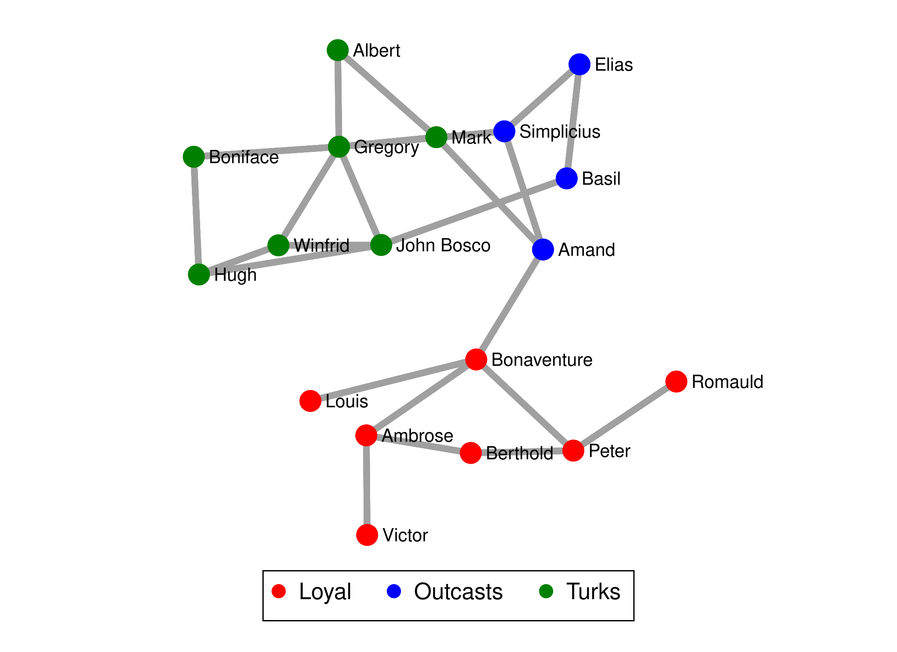
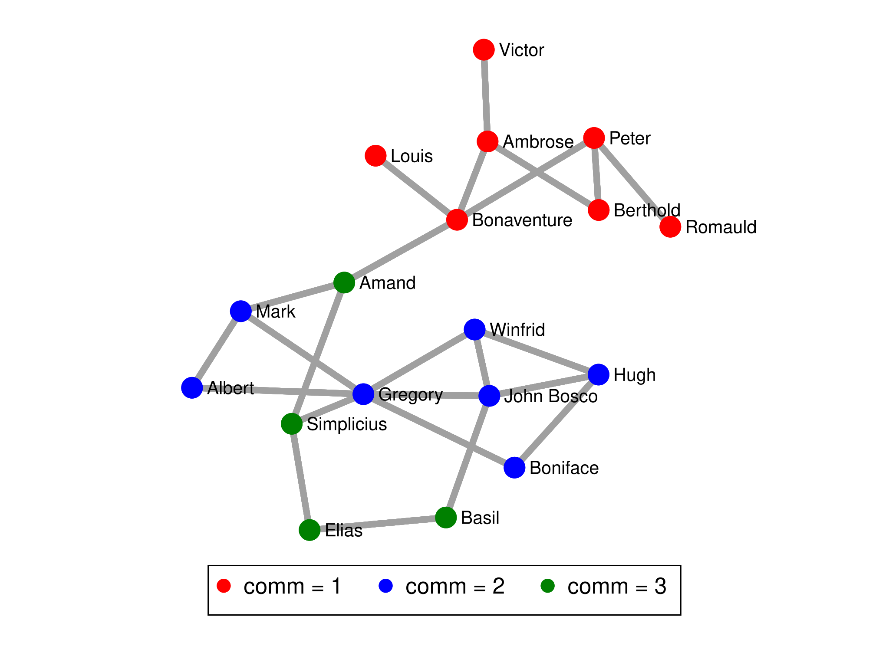

# Tutorial 10: Cohesion & Subgroups

"Which nodes belong together?" has no single answer. Some definitions ask who can reach whom (components), some ask
who is densely tied to whom (cores, cliques, k-plexes), and some ask for a partition of everybody into groups
(communities, factions, core and periphery). Each is a separate command in nwcommands, and each one answers a
different question. This tutorial runs them on two networks that come with the core: `mesa` (a school network with
205 students) for components, and Sampson's monks (`sampson`, 18 monks observed in a monastery) for everything else,
because the monks come with a known grouping (`faction`) to compare the results to.

The whole script is in [`example.do`](example.do), the complete output in [`example.log`](example.log). Every
command below that finds groups stores them in a new variable (`generate()`), so you can tabulate them against
anything else in the data set.

## Components: who can reach whom?

A **component** is a set of nodes that are all connected to one another by some path, directly or through others.
It is the loosest notion of cohesion: two nodes in the same component may be many steps apart.

```stata
. nwwebuse mesa, nwclear

. nwcomponents mesa, generate(compid) silent

. display r(components)
68

. bysort compid: generate csize = _N

. tabulate csize

      csize |      Freq.     Percent        Cum.
------------+-----------------------------------
          1 |         57       27.80       27.80
          2 |          8        3.90       31.71
          3 |         12        5.85       37.56
          4 |          8        3.90       41.46
        120 |        120       58.54      100.00
------------+-----------------------------------
      Total |        205      100.00
```

There are 68 components, but one of them, with 120 students, holds 59 percent of the school. The other 67 are
isolates and very small groups. Many network statistics (paths, closeness) are only meaningful inside one connected
piece, so a common step is to keep the largest one. `lgc` marks it:

```stata
. nwcomponents mesa, generate(lgc) lgc silent

. tabulate lgc

        lgc |      Freq.     Percent        Cum.
------------+-----------------------------------
          0 |         85       41.46       41.46
          1 |        120       58.54      100.00
------------+-----------------------------------
      Total |        205      100.00
```

## A network with a known group structure

Sampson recorded who liked whom among 18 novices in a monastery during a crisis. The monks split into three
factions, `Loyal`, `Outcasts` and `Turks`, which are stored as the string variable `faction` next to the network.
We symmetrize the "likes" ties (a tie exists if either monk liked the other) and use the result, `likes`, below.
The ties of `samplike` are valued, a liking rank from 1 to 3, and symmetrizing keeps the larger of the two directed values (`mode(max)`), so `likes` has the values 0 (no tie) to 3.

```stata
. nwwebuse sampson, nwclear

. nwsymmetrize samplike, generate(likes)

. nwsummarize likes
--------------------------------------------------
   Network name:  likes
   Network id:  5
   Directed: false
   Valued: true
   Two-mode: false
   Nodes: 18
   Selfloop: false
   Edges: 60
   Minimum value:  0
   Maximum value:  3
   Density:  .392
   Temporal: false
```

The commands in the next section use only whether a tie exists, not its value, and tell you so
(`note: tie values are ignored; this measure is binary`).

## Dense cores: k-cores, cliques and k-plexes

These definitions pick out *parts* of the network that are especially dense, and leave the rest unassigned.

* A **k-core** is a set of nodes who each have at least *k* ties inside the set. `nwkcore` gives every node its
  *coreness*, the highest *k* for which it belongs to a k-core.
* A **clique** is a set of nodes who are *all* tied to each other. Cliques are strict and overlap: one node can
  be in several of them. `nwclique` finds the maximal cliques of at least `minsize()` nodes.
* A **k-plex** relaxes the clique: each node may miss up to *k*-1 of the others. `nwkplex` finds maximal
  k-plexes.

```stata
. nwkcore likes, generate(kcore)
(note: tie values are ignored; this measure is binary)
----------------------------------------
  Network name: likes
  Max coreness (degeneracy): 5

      kcore |      Freq.     Percent        Cum.
------------+-----------------------------------
          4 |          4       22.22       22.22
          5 |         14       77.78      100.00
------------+-----------------------------------
      Total |         18      100.00

. nwclique likes, generate(clique) minsize(4)
(note: tie values are ignored; this measure is binary)
----------------------------------------
  Network name: likes
  Maximal cliques (size >= 4): 7

    Variable |        Obs        Mean    Std. dev.       Min        Max
-------------+---------------------------------------------------------
      clique |         12    5.083333    .9962049          4          6

. nwkplex likes, k(2) generate(plex) minsize(5)
(note: tie values are ignored; this measure is binary)
----------------------------------------
  Network name: likes
  Maximal 2-plexes (size >= 5): 21

    Variable |        Obs        Mean    Std. dev.       Min        Max
-------------+---------------------------------------------------------
        plex |         18    5.722222    .4608886          5          6
```

In this very dense network (density .39) 14 of 18 monks are in the 5-core, so the core is not a small elite
here. There are 7 maximal cliques of four or more monks. Because cliques overlap, the new variable `clique`
holds, for each monk, the size of the largest clique the monk belongs to (12 monks are in at least one), not a
partition. The same holds for `plex`. Use these commands when the question is "who is part of a tight knot?",
and a partition command (next sections) when the question is "which group is each person in?".

## Communities

`nwcommunity` splits everybody into non-overlapping groups so that there are many ties inside the groups and few
between them. It reports the **modularity** *Q*, the share of ties inside groups minus the share expected if ties
were placed at random; higher means a clearer group structure.

```stata
. nwcommunity likes, generate(comm)
----------------------------------------
  Network name: likes
  Communities: 3
  Modularity Q: .349

       comm |      Freq.     Percent        Cum.
------------+-----------------------------------
          1 |          7       38.89       38.89
          2 |          7       38.89       77.78
          3 |          4       22.22      100.00
------------+-----------------------------------
      Total |         18      100.00

. tabulate comm faction

           |             faction
      comm |     Loyal   Outcasts      Turks |     Total
-----------+---------------------------------+----------
         1 |         7          0          0 |         7 
         2 |         0          0          7 |         7 
         3 |         0          4          0 |         4 
-----------+---------------------------------+----------
     Total |         7          4          7 |        18 
```

The method found three communities without being told anything about the factions, and they coincide with the
factions exactly. To score *any* grouping, including one you made yourself, use `nwmodularity` with the group
variable (it needs a numeric variable, so the string `faction` is encoded first):

```stata
. encode faction, generate(fnum)

. nwmodularity likes, group(fnum)
----------------------------------------
  Network name: likes
  Communities: 3
  Modularity Q: .349
```

The `resolution()` option changes how fine the groups are; higher values give more, smaller groups:

```stata
. nwcommunity likes, generate(comm2) resolution(2)
----------------------------------------
  Network name: likes
  Communities: 5
  Modularity Q: .069
```

With resolution 2 the three factions are cut into five smaller groups, and the quality drops to .069, a reminder
that the number of groups the algorithm returns is a modelling choice, not a fact about the network.

## A fixed number of groups

When theory tells you how many groups to expect, `nwfactions` finds the best split into exactly that many
(`groups()`) and reports its fitness:

```stata
. nwfactions likes, groups(3) generate(fgroup)
----------------------------------------
  Network name: likes
  Groups: 3   Fitness: .611
```

Group numbers are arbitrary labels: here group 1 is the Turks and group 2 the Loyal monks, and the cross-tabulation
`tabulate fgroup faction` again recovers the factions exactly.

## Core and periphery

A different picture of structure: a **core** of well-connected nodes surrounded by a **periphery** that is tied
mostly to the core, not to each other. `nwcoreperiphery` finds the split that best fits this ideal:

```stata
. nwcoreperiphery likes, generate(cp)
----------------------------------------
  Network name: likes
  Core size: 3   Fitness: .25

. tabulate cp faction

           |             faction
        cp |     Loyal   Outcasts      Turks |     Total
-----------+---------------------------------+----------
         0 |         6          4          5 |        15 
         1 |         1          0          2 |         3 
-----------+---------------------------------+----------
     Total |         7          4          7 |        18 
```

The fitness is low (.25) and the three core monks come from two factions: this network is organized as groups,
not as a core with a periphery, and the command tells you so rather than forcing the picture.

## Plot the result

Any of the group variables can colour a plot. First the known factions, then the communities found:

```stata
. nwplot likes, color(faction) label(_nwnode) scheme(s1network) export("plot_sampson_faction.svg") replace
. nwplot likes, color(comm) label(_nwnode) scheme(s1network) export("plot_sampson_comm.svg") replace
```





## Which command when?

| Question | Command |
|---|---|
| Which nodes can reach each other at all? | `nwcomponents` |
| Which nodes are embedded in a dense part (and how deeply)? | `nwkcore` |
| Which sets of nodes are completely tied to each other? | `nwclique` (or `nwkplex` if some missing ties are allowed) |
| Divide everybody into groups, number of groups unknown | `nwcommunity` |
| Divide everybody into a number of groups I choose | `nwfactions` |
| How good is a grouping I already have? | `nwmodularity` |
| Is there a core and a periphery? | `nwcoreperiphery` |

The k-core, clique and k-plex commands ignore tie values; the others are described in the
[command reference](../../reference/). The notion of a group that the nwsaom and nwergm tutorials need,
a categorical node variable such as `faction`, is the same one used here.
