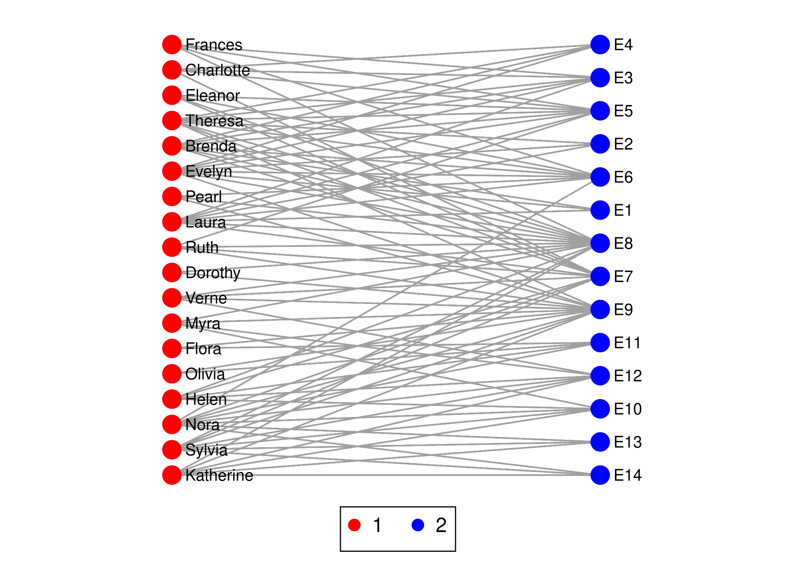

# Two-mode networks

In a **two-mode** (affiliation) network there are two kinds of nodes, and ties run only between the kinds, never
inside one: women and the social events they attend, directors and the companies on whose boards they sit. This
tutorial uses the two two-mode data sets that come with the core, `davis` (a small, classic one) and
`ftdirectors_se` (a large one), and shows how to describe such a network, count what each node is tied to, project it
onto one mode and plot it. The data sets, with their sources and licences, are described on the
[data sets](../../datasets/#two-mode-affiliation-networks) page.

{: .note }
`davis` and `ftdirectors_se` ship with core 3.4.0. With version 3.4.0 or later installed,
`nwwebuse davis` and `nwwebuse ftdirectors_se` load them, as shown below. The output on this page was produced from
the copies in the data folder of the repository, loaded with `nwuse`, which is the command `nwwebuse` calls.

## Southern women: 18 women, 14 events

Eighteen women of a Southern US town and the 14 social events they attended in 1936, as reported in the local
newspaper (Davis, Gardner and Gardner 1941). A tie means that the woman attended the event.

```stata
. nwwebuse davis, nwclear

. nwsummarize davis
--------------------------------------------------
   Network name:  davis
   Network id:  1
   Directed: false
   Valued: false
   Two-mode: true
   Nodes: 32
      Level 1: 18 (woman)
      Level 2: 14 (event)
   Selfloop: false
   Edges: 89
   Minimum value:  0
   Maximum value:  1
   Density:  .353
   Temporal: false
```

`Two-mode: true` and the two levels tell you what you have: 18 nodes of the first mode (`woman`) and 14 of the
second (`event`), 32 nodes and 89 ties in all. The density is the number of ties over the 18 x 14 = 252 pairs of one woman and one event (89 / 252 = .353; the
`bipartite` package of R calls it connectance), so it is not comparable with the density of a one-mode network (the same
graph read as one-mode has .179). The variable `_nwmode` (1 or 2) says which mode a row belongs to,
and the attributes belong to one mode each: `surname` and `title` to the women, `eventdate` to the events.

## Degree in a two-mode network

`nwdegree` counts the ties of each node. It recognises a two-mode network (a network declares itself two-mode when it is
created) and uses the two-mode form of the degree automatically: it divides the count by the number of nodes in the
*other* mode, so a woman who attended all 14 events has the value 1. Multiplying back gives plain counts (the option
`raw` gives the counts themselves, and `onemode` the degree of the bipartite graph read as a one-mode graph):

```stata
. nwdegree davis, generate(att)
----------------------------------------
  Network name: davis

    Variable |        Obs        Mean    Std. dev.       Min        Max
-------------+---------------------------------------------------------
         att |         32    .3531746     .171207   .1428571   .7777778

. generate attended = round(att * 14) if _nwmode == "1"
(14 missing values generated)

. generate guests = round(att * 18) if _nwmode == "2"
(18 missing values generated)

. list _nwnode surname title attended if _nwmode == "1", noobs

  +-------------------------------------------+
  |   _nwnode      surname   title   attended |
  |-------------------------------------------|
  |    Brenda       Rogers    Miss          7 |
  | Charlotte       McDowd    Miss          4 |
  |   Dorothy    Murchison     Mrs          2 |
  |   Eleanor          Nye    Miss          4 |
  |    Evelyn    Jefferson     Mrs          8 |
  |-------------------------------------------|
  |     Flora        Price     Mrs          2 |
  |   Frances     Anderson    Miss          4 |
  |     Helen        Lloyd     Mrs          5 |
  | Katherine       Rogers    Miss          6 |
  |     Laura   Mandeville    Miss          7 |
  |-------------------------------------------|
  |      Myra      Liddell    Miss          4 |
  |      Nora      Fayette     Mrs          8 |
  |    Olivia     Carleton     Mrs          2 |
  |     Pearl   Oglethorpe    Miss          3 |
  |      Ruth       DeSand    Miss          4 |
  |-------------------------------------------|
  |    Sylvia     Avondale     Mrs          7 |
  |   Theresa     Anderson    Miss          8 |
  |     Verne    Sanderson    Miss          4 |
  +-------------------------------------------+
```

Evelyn, Nora and Theresa attended the most events (8 each); Dorothy, Flora and Olivia only 2. The same variable
gives, for the second mode, the number of women who attended each event:

```stata
. gsort -guests

. list _nwnode eventdate guests in 1/3, noobs

  +-------------------------------+
  | _nwnode    eventdate   guests |
  |-------------------------------|
  |      E8   1936-09-16       14 |
  |      E9   1936-04-08       12 |
  |      E7   1936-03-15       10 |
  +-------------------------------+

. sort _nwmode _nwnode
```

The best attended event was `E8` (16 September 1936), with 14 of the 18 women.

## Projecting onto one mode

Two women are linked in the **projection** onto the women if they attended a common event, and the value of the tie
is the number of events they attended together. `nw2project` builds this one-mode network; `project(1)` keeps the
first mode, `project(2)` would keep the events:

```stata
. nw2project davis, project(1) name(women)
----------------------------------------
  Projected network: women
  Level: 1
  Nodes: 18
  Ties: 139

. nwsummarize women
--------------------------------------------------
   Network name:  women
   Network id:  2
   Directed: false
   Valued: true
   Two-mode: false
   Nodes: 18
   Selfloop: false
   Edges: 139
   Minimum value:  0
   Maximum value:  7
   Density:  .908
   Temporal: false
   Provenance:  projected from network davis, mode 1 (woman), stat=minmax
```

The projection is an ordinary network, and all one-mode commands work on it. It has 139 ties, the tie values go up to 7 shared events, and almost
all pairs of women share at least one event (density .908). That is typical of projections: a few well attended events
link everybody, so the projection is much denser than the two-mode network it came from. Use the tie values, not
just their presence, when you analyze it.

`nwcommunity` finds groups of women in the projection (Louvain, using the tie values):

```stata
. nwcommunity women, generate(group)
----------------------------------------
  Network name: women
  Communities: 2
  Modularity Q: .152

      group |      Freq.     Percent        Cum.
------------+-----------------------------------
          1 |          8       44.44       44.44
          2 |         10       55.56      100.00
------------+-----------------------------------
      Total |         18      100.00
```

It finds two communities, of 8 and 10 women. Community detection on a projection is a description of the shared
events, not a test of a theory about the women; how the groups compare with other analyses of these data depends on
the method, and nothing here claims that they reproduce any particular published partition.

## Plotting the two modes

`layout(bipartite)` places the two modes in two rows, ordered to reduce crossings; `vertical` makes them two columns,
which gives the names room. Since version 3.9.0 `nwplot` also draws the two modes with different symbols (circles for the first mode, diamonds for the second) and one colour each on its own; here `color(_nwmode)` is given, so only the symbols and the legend come from that default, and `symbol()` or `color()` of your own replaces it:

```stata
. nwplot davis, layout(bipartite, vertical) color(_nwmode) label(_nwnode) scheme(s1network) export("plot_davis.svg") repl
> ace
Calculating node coordinates...
Plotting network...
Exporting graph to plot_davis.svg...
(file plot_davis.svg not found)
file plot_davis.svg saved as SVG format
```



## A part of the network keeps its two modes

Dropping or keeping nodes does not turn a two-mode network into a one-mode network: the two-mode flag, the mode of every
remaining node and the level labels are kept, so every two-mode command still works on the part. Here are four women
and five events:

```stata
. nwkeepnodes davis, nodes(Brenda Charlotte Dorothy Eleanor E1 E2 E3 E4 E5) generate(small)

. nwsummarize small
--------------------------------------------------
   Network name:  small
   Network id:  3
   Directed: false
   Valued: false
   Two-mode: true
   Nodes: 9
      Level 1: 4 (woman)
      Level 2: 5 (event)
   Selfloop: false
   Edges: 8
   Minimum value:  0
   Maximum value:  1
   Density:  .4
   Temporal: false

. nwdegree small, generate(attsmall)
----------------------------------------
  Network name: small

    Variable |        Obs        Mean    Std. dev.       Min        Max
-------------+---------------------------------------------------------
    attsmall |          9          .4    .3010399          0         .8
 

```

The same holds for `nwsubset`, `nwduplicate`, `nwsym`, `nwtranspose`, `nwrecode`, `nwdichotomize`, `nwaddnodes` and
`nwpermute`. A network is declared two-mode in one place only (`nwset, twomode` or `bipartite`, `nw2fromedge`,
`nwfromedge, twomode`, `nwimport`, `nwuse`); no command works the flag out from the ties, and `nwname`, `new2mode(true)`
refuses a network that has no second mode or a tie inside a mode.

## Communities of the two-mode network itself

`nwcommunity` and `nwmodularity` use the bipartite modularity of Barber (2007) on a two-mode network: the expected
number of ties is computed only for pairs of nodes from different modes, because no other pair can be tied. This is the
modularity of `bipartite::computeModules` in R. The option `onemode` gives Newman's modularity of the same graph read as
a one-mode graph, as `igraph::cluster_louvain` computes it:

```stata
. nwcommunity davis, generate(comm_bip) seed(1)
----------------------------------------
  Network name: davis
  Communities: 4
  Modularity Q (Barber, two-mode): .346

   comm_bip |      Freq.     Percent        Cum.
------------+-----------------------------------
          1 |          5       15.62       15.62
          2 |          9       28.12       43.75
          3 |         12       37.50       81.25
          4 |          6       18.75      100.00
------------+-----------------------------------
      Total |         32      100.00
 

. nwcommunity davis, generate(comm_one) onemode seed(1)
----------------------------------------
  Network name: davis
  Communities: 3
  Modularity Q: .332

   comm_one |      Freq.     Percent        Cum.
------------+-----------------------------------
          1 |         12       37.50       37.50
          2 |         14       43.75       81.25
          3 |          6       18.75      100.00
------------+-----------------------------------
      Total |         32      100.00
 

. nwmodularity davis, group(comm_bip)
----------------------------------------
  Network name: davis
  Communities: 4
  Modularity Q (Barber, two-mode): .346
 

. nwmodularity davis, group(comm_bip) onemode
----------------------------------------
  Network name: davis
  Communities: 4
  Modularity Q: .333
 

```

For the Southern women the search finds four groups of women and events together with Q = .346 (`computeModules` finds
the same value); the one-mode modularity finds three groups with Q = .332. The same partition has Q = .346 as a
bipartite and .320 as a one-mode modularity. The groups contain nodes of both modes, which is the point: a group is a
set of women and the events they went to. The search is a Louvain-type search from several starting orders (`starts()`,
30 by default; use `seed()` for reproducibility).

## Nestedness and clustering

`nw2nested` measures how nested the network is, whether the events attended by the women with few events are also
attended by the women with many (NODF of Almeida-Neto et al. 2008, and the C-score of Stone and Roberts 1990, as in the
`bipartite` package of R):

```stata
. nw2nested davis
------------------------------------------------------------
  Network name: davis
  NODF (Almeida-Neto et al. 2008):   48.5812
      among the nodes of mode 1:   48.2057    of mode 2:   49.2125
  C-score, pairs of mode-2 nodes:   12.5934   normalised (0-1):    0.4494
------------------------------------------------------------

```

There are two clustering coefficients for a two-mode network, and they answer different questions. `nwclustering`
(which uses the two-mode form on a two-mode network) gives the coefficient of Opsahl (2013), the share of four-paths that a fifth tie closes (R: `tnet::clustering_tm`),
.772 here. With `ra` it gives the global coefficient of Robins and Alexander (2004), four times the number of
four-cycles over the number of three-paths, .468 here. Say which one you report.

```stata
. nwclustering davis, generate(clo)

. display r(C_global)
.7718968

. nwclustering davis, ra
  Robins-Alexander clustering (4 x C4 / L3):  0.467764   (C4 = 341, L3 = 2916)

```

## Motifs: what shapes the network is made of

A **bipartite motif** is a small connected pattern of women and events, such as one woman at one event (motif 1), a woman at two events (motif 2) or a four-cycle of two women who both attended two events (motif 6). `nwmotifs` counts the 17 motifs of two to five nodes (the option `sixnode` adds the 27 motifs of six nodes) in the way of Simmons et al. (2019) and numbers them as the R package `bmotif` does, so that the table can be compared with R. It also counts, for every node, how often the node takes each of the 46 positions in the motifs (the position ids are those of `bmotif`) and stores them in the variables `np1` to `np46`:

```stata
. nwmotifs davis, generate(np)
Bipartite motifs of davis: 2 to 5 nodes; rows = mode 1 (18 nodes), columns = mode 2 (14 nodes)
------------------------------------------
 motif  nodes    r x c           frequency
------------------------------------------
     1      2      1x1                  89
     2      3      1x2                 214
     3      3      2x1                 322
     4      4      3x1                 878
     5      4      2x2                1552
     6      4      2x2                 341
     7      4      1x3                 328
     8      5      4x1                1883
     9      5      3x2                4288
    10      5      3x2                1867
    11      5      3x2                2415
    12      5      3x2                 389
    13      5      2x3                2249
    14      5      2x3                1733
    15      5      2x3                1284
    16      5      2x3                 267
    17      5      1x4                 341
------------------------------------------
Node position counts stored in np1 to np46 (position ids of bmotif), nodes in network order.

. list _nwnode np1 np2 np3 np4 np5 np6 in 1/3, noobs

  +-----------------------------------------------+
  |   _nwnode   np1   np2   np3   np4   np5   np6 |
  |-----------------------------------------------|
  |    Brenda     0     7     0    21     0    46 |
  | Charlotte     0     4     0     6     0    24 |
  |   Dorothy     0     2     0     1     0    24 |
  +-----------------------------------------------+
```

Motif 6 is the four-cycle: two women who attended the same two events. There are 341 of them among the 18 women and 14 events, which is the number C4 behind the Robins-Alexander coefficient above. The position counts say what role a node plays in each motif. `np1` and `np2` are the two positions of motif 1 (a single tie), `np3` and `np4` those of motif 2 (one woman at two events), `np5` and `np6` those of motif 3 (two women at one event). A node can only take the positions of its own mode, so for a woman `np1`, `np3` and `np5` are 0. Brenda's `np2` = 7 is the number of events she attended, her `np4` = 21 the number of pairs of her events (7 over 2) and her `np6` = 46 the number of times she shared an event with another woman (the other guests, event by event). Each count is a number of occurrences of the motif that contain the node, so the positions of all nodes add up to the motif frequencies times the number of nodes of the motif. `nwmotifs, onemode` counts the 4-node subgraphs of the bipartite graph read as a one-mode graph instead (what `igraph::motifs` gives); the numbering and the counts of the bipartite motifs are those of the R package `bmotif` (Simmons et al. 2019).

## Closeness and betweenness for two modes

`nwcloseness` and `nwbetween` are defined on any graph, but in a two-mode network a woman can be at most one step from every event and two steps from every other woman, so the raw numbers of the bipartite graph are not comparable between the two modes. The commands therefore normalise as Borgatti and Everett (1997) do: closeness is the smallest possible farness of a node of its mode divided by its farness, and betweenness is divided by the largest value a node of its mode can reach. `onemode` gives the numbers of the bipartite graph read as a one-mode graph (the `twomode` option of earlier versions is the default now and still accepted):

```stata
. nwcloseness davis, generate(cl_ cf_ cn_) silent

. nwcloseness davis, generate(clo1 cfo1 cno1) onemode silent

. summarize cl_ clo1

    Variable |        Obs        Mean    Std. dev.       Min        Max
-------------+---------------------------------------------------------
         cl_ |         32    .6591892    .0993221   .5238096   .8461539
        clo1 |         32    .4413106    .0612054   .3690476   .5961539

. nwbetween davis, generate(bw) silent
----------------------------------------
  Network name: davis
----------------------------------------
    Betweenness centrality
    (standardized by the largest possible value in a two-mode network, Borgatti and Everett 1997)

. nwbetween davis, generate(bw1) onemode silent
----------------------------------------
  Network name: davis
----------------------------------------
    Betweenness centrality

. summarize bw bw1

    Variable |        Obs        Mean    Std. dev.       Min        Max
-------------+---------------------------------------------------------
          bw |         32    .0451195    .0606926   .0019535   .2438195
         bw1 |         32       20.25    27.37569   .8693194   110.2064
```

The normalised closeness of the nodes runs from .52 to .85 (mean .66) and the raw closeness of the bipartite graph from .37 to .60; the normalised betweenness runs from .002 to .24, the raw betweenness from .87 to 110. Compare nodes of the same mode with each other; the normalisation makes the two modes comparable.

## A null model for two-mode networks

`nwpermute` of a two-mode network permutes the labels within the two modes, so that no tie ever joins two women or two
events. With `swap` it exchanges the partners of two ties at random and keeps the degree of every node (the
`swap.web` null model of the `bipartite` package):

```stata
. set seed 1

. nwpermute davis, generate(davis_swap) swap

. nwdegree davis_swap, generate(att_swap) raw silent

. nwdegree davis, generate(att_raw) raw silent

. assert att_swap == att_raw

```

## Saving and exchanging two-mode networks

`nwexport` writes a two-mode network in the form each format has for it, and `nwimport` reads it back as a two-mode
network: Pajek `*Vertices n n1` (first mode first), UCINET a rectangular matrix, the plain edge list five columns
(ego, alter, value and the mode of both nodes), GML a node attribute `nwmode`. `nwtoedge` and `nw2toedge` write the
ties between the modes, and `nwfromedge ..., twomode` or `nw2fromedge` reads that list back:

```stata
. nwexport davis, type(pajek) fname(davis_pajek) replace
Exporting network: davis
Saved as file: davis_pajek.net

. nwimport davis_pajek.net, type(pajek) name(davis_back) nwappend
------------------------------
Importing successful

. nwsummarize davis_back
--------------------------------------------------
   Network name:  davis_back
   Network id:  5
   Directed: false
   Valued: false
   Two-mode: true
   Nodes: 32
      Level 1: 18 (woman)
      Level 2: 14 (event)
   Selfloop: false
   Edges: 89
   Minimum value:  0
   Maximum value:  1
   Density:  .353
   Temporal: false

. erase davis_pajek.net

```

Pajek, the edge list and GML keep the names of the two levels (UCINET DL has no place for them and gives `rows` and
`columns`), and `nwsave` and `nwuse` keep them too.

## What stops on a two-mode network

Some commands would read the blocks of the adjacency matrix between nodes of the same mode, which hold no ties:
`nwspectral`, `nwrandomwalk`, `nwcorrelate` (the profiles of the nodes of one network), `nwhierarchy`, `nwconcor`,
`nwfactions`, `nwcoreperiphery`, `nwqap`, `nwinduced` and `nwcollapse`. They stop with one message and the
error 6088 instead of returning missing values. Make a one-mode network of one mode with `nw2project` first, or, for
`nwspectral` and `nwrandomwalk`, use the option `onemode` to read the bipartite graph as an ordinary graph (as `igraph`
does). The commands that are defined on any graph (`nwcomponents`, `nwkcore`, `nwgeodesic`, `nwpagerank`, ...) give the
numbers of the bipartite graph. The table of [network types](../../nwcommands/network-types/) lists
all commands, and the page on [two-mode networks](../../nwcommands/two-mode/) explains the rules.

```stata
. capture noisily nwspectral davis, generate(sp)
nwspectral does not support two-mode networks (davis): it reads the blocks between nodes of the same mode, which hold no 
> ties. Make a one-mode network of one mode first (nwproject). The option onemode reads the two-mode network as a one-mod
> e graph.

. display _rc
6088

```

## A large two-mode network: company directors in Sweden

`ftdirectors_se` is a subset of a data set of directors and companies compiled from the Financial Times web site
(Evtushenko and Gastner 2019; licence and the changes made are on the [data sets](../../datasets/#ftdirectors_se-company-directors-in-sweden) page):
the 455 Swedish listed companies and all 5,092 directors who sit on their boards.

```stata
. nwwebuse ftdirectors_se, nwclear

. nwsummarize ftdirectors_se
--------------------------------------------------
   Network name:  ftdirectors_se
   Network id:  1
   Directed: false
   Valued: false
   Two-mode: true
   Nodes: 5547
      Level 1: 5092 (director)
      Level 2: 455 (company)
   Selfloop: false
   Edges: 5669
   Minimum value:  0
   Maximum value:  1
   Density:  .00245
   Temporal: false
```

The commands are the same, only the size differs: 5,547 nodes and 5,669 ties. How many boards does a director sit on?

```stata
. nwdegree ftdirectors_se, generate(deg)
----------------------------------------
  Network name: ftdirectors_se

    Variable |        Obs        Mean    Std. dev.       Min        Max
-------------+---------------------------------------------------------
         deg |      5,547    .0024468    .0010275   .0005892   .0153846

. generate boards = round(deg * 455) if _nwmode == "1"
(455 missing values generated)

. tabulate boards

     boards |      Freq.     Percent        Cum.
------------+-----------------------------------
          1 |      4,702       92.34       92.34
          2 |        268        5.26       97.60
          3 |         81        1.59       99.19
          4 |         26        0.51       99.71
          5 |          8        0.16       99.86
          6 |          5        0.10       99.96
          7 |          2        0.04      100.00
------------+-----------------------------------
      Total |      5,092      100.00
```

Nine in ten directors (92.3 percent) sit on one board; 390 sit on two to seven. Directors and companies carry
attributes (gender and age; sector, industry and number of employees), so attribute questions are ordinary Stata
questions. Gender is missing for 582 directors:

```stata
. tabulate gender if _nwmode == "1", missing

     gender |      Freq.     Percent        Cum.
------------+-----------------------------------
            |        582       11.43       11.43
     Female |      1,025       20.13       31.56
       Male |      3,485       68.44      100.00
------------+-----------------------------------
      Total |      5,092      100.00

. tabstat boards if _nwmode == "1", by(gender) statistics(mean count)

Summary for variables: boards
Group variable: gender 

gender |      Mean         N
-------+--------------------
Female |  1.190244      1025
  Male |  1.098709      3485
-------+--------------------
 Total |  1.119512      4510
----------------------------
```

Among the directors whose gender is known, the women sit on slightly more boards on average (1.19) than the men
(1.10). This is a description of this subset, which holds only Swedish companies; it says nothing about causes.

The projection onto the companies links two companies when they share a director. Its tie value is the number of
shared directors:

```stata
. nw2project ftdirectors_se, project(2) name(companies)
----------------------------------------
  Projected network: companies
  Level: 2
  Nodes: 455
  Ties: 759

. nwsummarize companies
--------------------------------------------------
   Network name:  companies
   Network id:  2
   Directed: false
   Valued: true
   Two-mode: false
   Nodes: 455
   Selfloop: false
   Edges: 759
   Minimum value:  0
   Maximum value:  5
   Density:  .00735
   Temporal: false
   Provenance:  projected from network ftdirectors_se, mode 2 (company), stat=minmax
```

Only 759 of the 103,285 possible pairs of companies share a director (density .007). The components of the
projection show how the companies fall apart into groups of interlocked boards:

```stata
. quietly nwcomponents companies, generate(comp)

. display r(components)
132

. egen size = count(comp), by(comp)

. summarize size, meanonly

. display r(max)
304

end of do-file
```

The 455 companies form 132 components; the largest holds 304 companies, and many of the others consist of a single
company without a director in common with any other.

{: .note }
For plots, project onto the companies first: a plot of all 5,547 nodes of the two-mode network is unreadable. A
two-mode network is stored as one matrix over both modes, so the size limits count the nodes of both modes together
(see [How large a network can I analyze?](../../nwcommands/size-limits/)).

## What to remember

- `nwsummarize` shows `Two-mode: true` and the sizes of the two modes; `_nwmode` marks the mode of each row.
- A command that has a two-mode form of the same concept uses it automatically on a two-mode network, and `onemode` forces the one-mode computation. `nwdegree` divides the number of ties by the size of the other mode (`raw` gives the counts).
- `nw2project, project(1)` and `project(2)` give the two one-mode networks, with the number of shared neighbors as
  tie value. The projections are dense when a few nodes of the other mode have many ties.
- After a projection, the whole one-mode toolbox applies: `nwcomponents`, `nwcommunity`, `nwdegree` and the others.
- `nwclustering` gives clustering coefficients for two-mode networks (Opsahl by default, `ra` for Robins and Alexander), `nwmotifs` the bipartite motifs and the position of every node in them, `nw2nested`
  the nestedness, and `nwplot` has `layout(bipartite)`. The older names `nw2degree`, `nw2clustering` and `nw2motifs` still work.
- `nwcloseness` and `nwbetween` normalise for the two modes (Borgatti and Everett); `onemode` gives the raw numbers.
- A two-mode network stays two-mode when you drop or keep nodes, subset it, export it or write it as an edge list.
- `nwcommunity` and `nwmodularity` use the bipartite modularity of Barber by default (`onemode` for Newman's).
- The commands that cannot say anything about a two-mode network stop with error 6088.

The commands of this tutorial are in `example.do` in the folder of the tutorial; its log is `example.log`.
