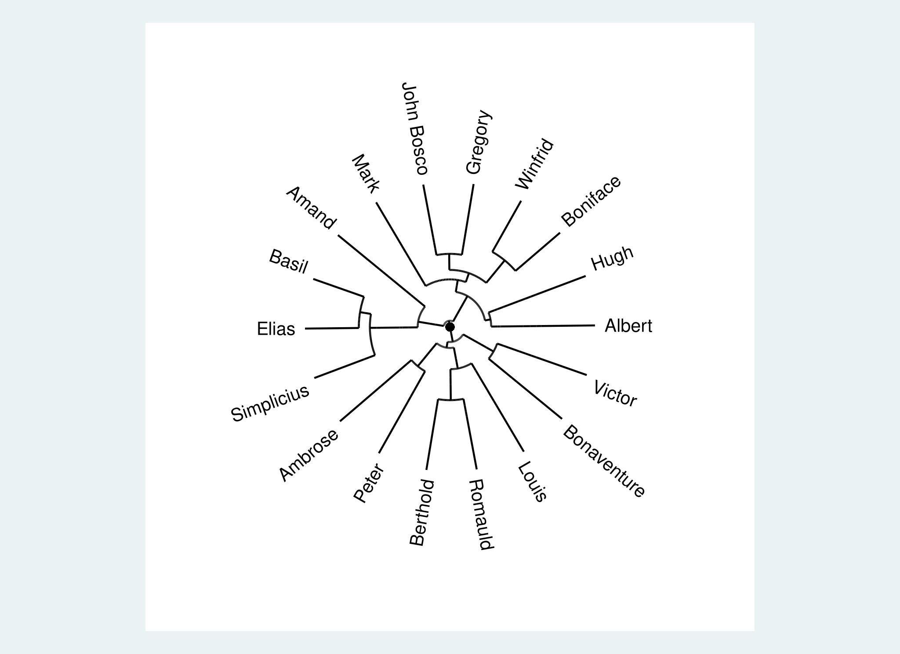

# Tutorial 13: Positions & Equivalence

Two monks in a monastery may never speak to each other and yet occupy the same *position*: they are liked by the
same people and like the same people. Network analysts call such nodes **structurally equivalent**: they have the
same ties to the same others. Finding sets of nodes with similar tie profiles reveals the roles in a network, which can be
quite different from the cohesive subgroups of [Tutorial 10](../10-cohesion-subgroups/): a group of "leaders" who
do not know each other, or a set of "followers" who all look up to the same few people.

The tutorial uses the "likes" network of Sampson's monks (`samplike`, 18 monks, directed) and compares the
positions found with the monks' three known factions. The script is [`example.do`](example.do), the complete
output [`example.log`](example.log).

## Similarity and dissimilarity of tie profiles

The **tie profile** of a node is its row (outgoing ties) and column (incoming ties) of the adjacency matrix.
Two nodes are structurally equivalent if their profiles are the same. `nwsimilar` and `nwdissimilar` compare the
profiles of all pairs of nodes and save the result as a new network:

```stata
. nwwebuse sampson, nwclear

. nwdissimilar samplike, type(euclidean) name(dist)

. nwdissimilar samplike, type(jaccard) name(jdist)

. nwsimilar samplike, name(sim)

. nwsummarize sim
--------------------------------------------------
   Network name:  sim
   Network id:  7
   Directed: true
   Valued: true
   Two-mode: false
   Nodes: 18
   Selfloop: false
   Arcs: 304
   Minimum value:  -.392
   Maximum value:  .945
   Density:  .993
   Temporal: false
```

`nwdissimilar` offers the distances `euclidean` (the default), `manhatten`, `hamming`, `jaccard` and
`nonmatches`; with `context(incoming)` or `context(outgoing)` only one direction of ties is compared. `nwsimilar` gives
the correlation of tie profiles: here it runs from -.39 (opposite profiles) to .95 (almost the same ties). The
results are ordinary networks, so they can be plotted, listed or analyzed like any other.

## Hierarchical clustering: `nwhierarchy`

`nwhierarchy` clusters the nodes by the dissimilarity of their tie profiles. Start with every node on its own,
merge the two closest nodes or groups, and repeat; the result is a tree. `groups()` cuts it into the number of
classes you ask for and stores them in a variable. Because the tree depends on how the distance between groups
is defined, `linkage()` matters: `singlelinkage` (the default) is quick but chains nodes together, `averagelinkage` and
`completelinkage` give more compact groups.

```stata
. nwhierarchy samplike, type(jaccard) linkage(averagelinkage) groups(3) equivgen(equiv)

. tabulate equiv faction

           |             faction
     equiv |     Loyal   Outcasts      Turks |     Total
-----------+---------------------------------+----------
         1 |         0          0          7 |         7 
         2 |         0          4          0 |         4 
         3 |         7          0          0 |         7 
-----------+---------------------------------+----------
     Total |         7          4          7 |        18 

. nwdendrogram _nwhierarchy_role, label(_nwnode)
. graph export "dendrogram_sampson.svg", replace
```

With the Jaccard distance and average linkage, the three classes are exactly the three factions: monks in the same
faction have the same likes and are liked by the same monks. `nwdendrogram` draws the tree
(the height at which two branches join is their distance):



The result depends on the choices. With the default Euclidean distance and single linkage, the same call
puts 16 of the 18 monks into one class and one monk each in two others, a typical sign of chaining. Try
several measures and linkages and see whether the partition is stable, before reading anything into it.

## Blocks of equivalent nodes: CONCOR

CONCOR (Breiger, Boorman and Arabie 1975) is the classic block-modelling method. It correlates the tie profiles
of all nodes, then correlates the correlation matrix with itself again and again until it converges to +1
and -1; the sign splits the nodes into two groups. Each group can be split again. After `splits(2)` there are up
to four blocks:

```stata
. nwconcor samplike, generate(block) splits(2)
----------------------------------------
  Network name: samplike
  Splits: 2   Blocks found: 4

      block |      Freq.     Percent        Cum.
------------+-----------------------------------
          1 |          7       38.89       38.89
          2 |          3       16.67       55.56
          3 |          4       22.22       77.78
          4 |          4       22.22      100.00
------------+-----------------------------------
      Total |         18      100.00

. tabulate block faction

           |             faction
     block |     Loyal   Outcasts      Turks |     Total
-----------+---------------------------------+----------
         1 |         0          0          7 |         7 
         2 |         0          3          0 |         3 
         3 |         3          1          0 |         4 
         4 |         4          0          0 |         4 
-----------+---------------------------------+----------
     Total |         7          4          7 |        18 
```

The first split separates the Turks (block 1) from the others. The second splits the Loyal and Outcasts
monks, but not along the factions: three Loyal monks and one Outcast form block 3, so CONCOR sees a position
the factions do not show. CONCOR always splits in two, so the number of blocks is a power of two. If the
number of positions matters, use `nwhierarchy`; if a hierarchy of binary splits is what you want, CONCOR is
the classic.

## One split from the eigenvectors: `nwspectral`

`nwspectral` takes the Fiedler vector, the eigenvector that belongs to the second-smallest eigenvalue of the Laplacian matrix
of the network. Nodes with the same sign on it are on the same side of the best two-way cut:

```stata
. nwspectral samplike, generate(fiedler) bipartition
----------------------------------------
  Network name: samplike
  Connected components: 1
  Algebraic connectivity: 3.403

. tabulate fiedlersign faction

fiedlersig |             faction
         n |     Loyal   Outcasts      Turks |     Total
-----------+---------------------------------+----------
        -1 |         0          4          6 |        10 
         1 |         7          0          1 |         8 
-----------+---------------------------------+----------
     Total |         7          4          7 |        18 
```

The variable `fiedler` holds each monk's score and `fiedlersign` the side. The two sides separate the Loyal monks
from the Outcasts and Turks (one Turk is on the Loyal side). Unlike the partitions above, this is a cut that separates
densely connected groups, not a comparison of tie profiles: it belongs with the community methods of
[Tutorial 10](../10-cohesion-subgroups/). The *algebraic connectivity* (3.4) is the second-smallest eigenvalue;
it is 0 if the network is not connected and larger the harder it is to cut the network in two.

## Which command when?

| Question | Command |
|---|---|
| How similar are two nodes' tie profiles? | `nwsimilar`, `nwdissimilar` |
| Group nodes by profile, number of groups my choice, with a tree | `nwhierarchy`, `nwdendrogram` |
| Classic block-model with binary splits | `nwconcor` |
| Best two-way cut of the network | `nwspectral` |
| Densely connected subgroups rather than similar profiles | [Tutorial 10](../10-cohesion-subgroups/) |
