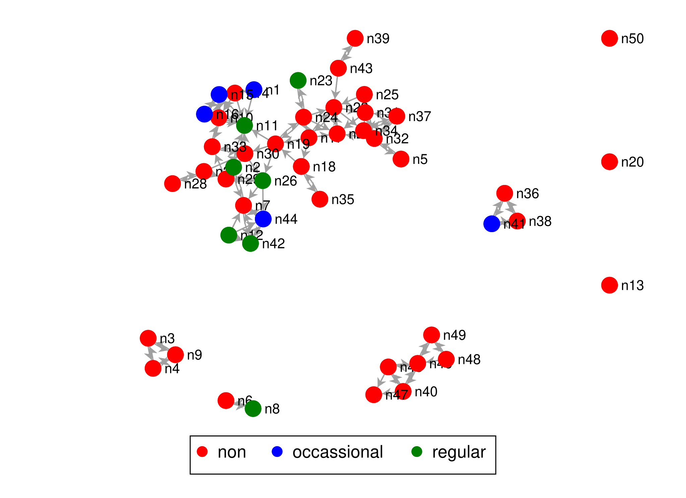

# Tutorial 14: Homophily, Assortativity & Mixing

"Birds of a feather flock together": friends tend to resemble each other in age, behavior or attitudes.
Two things can produce this. People may *choose* friends who are like them (selection), or friends may
*become* alike (influence). The commands in this tutorial describe the pattern itself, whatever its
cause: **do ties connect similar nodes more often than chance would?** The model-based tutorials of
[nwsaom](../../nwsaom/) separate selection from influence.

The data are the 50 pupils of the Glasgow friendship study that come with the core (`glasgow`): three
waves of the friendship network (`glasgow1`, `glasgow2`, `glasgow3`) and, for each wave, the pupil's
sport (`sport1`: 1 = not regular, 2 = regular), smoking (`smoke1`: 1 = non, 2 = occasional, 3 = regular)
and alcohol use (`alcohol1`: 1 to 5). The script is [`example.do`](example.do), the complete output
[`example.log`](example.log).

```stata
. nwwebuse glasgow, nwclear

. nwsummarize glasgow1
--------------------------------------------------
   Network name:  glasgow1
   Network id:  1
   Directed: true
   Valued: false
   Two-mode: false
   Nodes: 50
   Selfloop: false
   Arcs: 113
   Minimum value:  0
   Maximum value:  1
   Density:  .0461
   Temporal: false
```

## A number across ties: assortativity

`nwassortativity` takes a numeric node attribute and computes the correlation between its value at one end of
a tie and its value at the other end (Newman's assortativity coefficient). It runs from -1 (ties join
*dissimilar* nodes) to +1 (ties join *similar* nodes). Without `attribute()` the attribute is the node's own
degree: do popular pupils befriend other popular pupils?

```stata
. nwassortativity glasgow1

  Network name: glasgow1
  Attribute: degree
----------------------------------------
    Ties: 74
    Assortativity coefficient: .172

. nwassortativity glasgow1, attribute(alcohol1)

  Network name: glasgow1
  Attribute: alcohol1
----------------------------------------
    Ties: 74
    Assortativity coefficient: .323

. nwassortativity glasgow1, attribute(sport1)

  Network name: glasgow1
  Attribute: sport1
----------------------------------------
    Ties: 74
    Assortativity coefficient: .069
```

Pupils who drink more tend to be tied to others who drink more (.32), pupils with many ties are mildly
tied to others with many ties (.17), and sport hardly matters (.07). Note `Ties: 74`: the network has 113 arcs,
but the coefficient treats a directed network's ties as connections in either direction, so a mutual
friendship counts once. The command gives a coefficient but no p-value; for a test see
[Tutorial 18](../18-testing/).

## A category across ties: mixing tables and the E-I index

For a categorical attribute, `nwmixing` cross-tabulates every tie by the category of its sender (ego) and
of its receiver (alter), and computes the **E-I index** (Krackhardt and Stern 1988): external ties minus
internal ties, divided by all ties. It is -1 if every tie stays within a category, +1 if every tie crosses
categories. Its p-value comes from permuting the network (QAP) while keeping the attribute fixed.

```stata
. nwmixing glasgow1, attribute(sport1) permutations(500)

   Network:  glasgow1      Directed: true
   Attribute:  sport1

 sport1_ego | sport1_alter
            | not regular     regular        Total
------------+-------------------------------------
not regular |          13          17           30
regular     |          21          62           83
------------+-------------------------------------
Total       |          34          79          113

   E-I Index: -.327   p-value: .348
```

Of 113 arcs, 75 (13 + 62) join pupils of the same sport category: an E-I index of -.33. That looks like
homophily, but 70 percent of the ties *go to* regular sport players, who are the large group, so most
ties land inside it anyway. The permutation p-value (.35) says the pattern is no stronger than what the group
sizes alone would produce. Read the index together with its p-value, and with the table.

Smoking has three categories:

```stata
. nwmixing glasgow1, attribute(smoke1) permutations(500)

   Network:  glasgow1      Directed: true
   Attribute:  smoke1

 smoke1_ego | smoke1_alter
            |         non occassional     regular        Total
------------+-------------------------------------------------
non         |          71           5          11           87
occassional |           5           2           4           11
regular     |           7           5           3           15
------------+-------------------------------------------------
Total       |          83          12          18          113

   E-I Index: -.345   p-value: .22
```

Any other option is passed on to the underlying `tabulate`, so row percentages show where each group's ties go:

```stata
. nwmixing glasgow1, attribute(smoke1) permutations(1) row

            |           smoke1_alter
 smoke1_ego |       non  occassion    regular |     Total
------------+---------------------------------+----------
        non |        71          5         11 |        87 
            |     81.61       5.75      12.64 |    100.00 
------------+---------------------------------+----------
occassional |         5          2          4 |        11 
            |     45.45      18.18      36.36 |    100.00 
------------+---------------------------------+----------
    regular |         7          5          3 |        15 
            |     46.67      33.33      20.00 |    100.00 
------------+---------------------------------+----------
      Total |         83         12         18 |       113 
            |     73.45      10.62      15.93 |    100.00 
   E-I Index: -.345
```

82 percent of the non-smokers' ties go to other non-smokers, against 73 percent of all ties. For the
occasional and regular smokers the largest share of ties also goes to non-smokers, simply because there are
so many of them. With `permutations(1)` the permutation test is skipped. `eiplot` draws the null distribution
and `plot` draws the table with `tabplot`.

## Is a network like another one? `nwcorrelate`

The same idea works between networks: the correlation between the cells of two networks over the same
nodes. For the same friendship network observed twice it measures stability:

```stata
. nwcorrelate glasgow1 glasgow2
----------------------------------------
  Network1 name: glasgow1
  Network2 name: glasgow2
----------------------------------------
    Correlation: .473
```

A correlation of .47 means that friendships in the first wave are a strong predictor of friendships in the
second, although far from identical. The significance test for this is in [Tutorial 18](../18-testing/).

## Plot

```stata
. nwplot glasgow1, color(smoke1) label(_nwnode) scheme(s1network) export("plot_glasgow_smoke.svg") replace
```



## Which command when?

| Question | Command |
|---|---|
| Do ties join nodes with similar *numbers* (age, income, degree)? | `nwassortativity` |
| Do ties join nodes of the same *category*? How many go where? | `nwmixing` |
| How similar are two networks on the same nodes? | `nwcorrelate` |


Neither command says *why* similar nodes are tied. For that, see the
[nwsaom tutorials](../../nwsaom/) on selection and influence.
